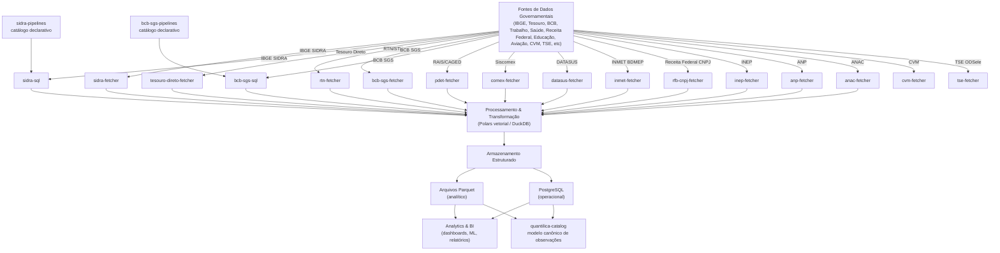

# Arquitetura do Ecossistema

Como o Ecossistema Quantilica é organizado e como as partes se conectam. Esta página descreve a forma do sistema; os [Princípios de Design](principios.md) explicam **por que** ele tem essa forma.

## Visão de sistema

O ecossistema é organizado em **quatro camadas**: extração, processamento, armazenamento, análise. Cada camada tem responsabilidades estritas.

## Fundações Técnicas

A infraestrutura da Quantilica repousa sobre o princípio da **Neutralidade de Domínio**. O pacote `quantilica-core` não possui conhecimento sobre fontes específicas (SIDRA, DATASUS, etc); ele lida exclusivamente com abstrações técnicas.

A fundação é dividida em dois pilares para equilibrar leveza e poder:

1.  **`quantilica-core` (Infraestrutura de I/O):** Base estável e sem dependências binárias pesadas. Contém clientes HTTP/FTP resilientes, gerenciamento de manifestos (proveniência) e utilitários de armazenamento atômico. A leitura resiliente de CSV com os péssimos encodings do Brasil fica no `quantilica-analytics`.
2.  **`quantilica-analytics` (Data Access Layer):** Camada analítica construída sobre o Polars e o PyArrow. Responsável por leitura lazy multi-formato, conversão otimizada para Parquet e contratos de dados (schemas). O `quantilica-catalog` acompanha definindo a visão sistêmica unificada.

### Tipos de Pacotes no Ecossistema

| Tipo | Padrão Esperado | Exemplos |
| :--- | :--- | :--- |
| **Client (Fetcher)** | Biblioteca Python + CLI simples | `sidra-fetcher`, `bcb-sgs-fetcher` |
| **Data Extractor (Bulk)** | Download massivo com manifestos. Só alguns têm `convert` para Parquet (extra `analysis`) | `rfb-cnpj-fetcher` e `inep-fetcher` (só baixam); `pdet-fetcher` e `datasus-fetcher` (também convertem) |
| **Pipeline DB** | Motor ETL + definições TOML/SQL | `sidra-sql`, `bcb-sgs-sql` |
| **Catálogo de pipelines** | Repositório Git com `manifest.toml` + `fetch.toml`/`transform.sql` por pipeline | `sidra-pipelines`, `bcb-sgs-pipelines` |
| **CLI Host** | Hub unificado (PyPI) com instalação de fontes sob demanda (`quantilica install`) | `quantilica-cli` |

> **Escopo deste site:** documentamos apenas contratos públicos (instalação, CLI, schemas, pipelines declarativos). Componentes operacionais internos — agendadores, rotinas de produção, infraestrutura — são intencionalmente indocumentados aqui.

## Camadas e responsabilidades

### Extração (Os Fetchers)

Obter dados de APIs, páginas de HTML arcaicas e servidores FTP falhos com resiliência militar.
*Tamanho somado: centenas de GB em centenas de milhares de arquivos (só o catálogo do DATASUS lista mais de 184 mil).*

**Faz:**
- Trata pegadinhas governamentais: paginação silenciosa, fallbacks de extensões, instabilidade de servidores defasados (como o SISCOMEX) e falhas transitórias do FTP (DATASUS).
- Corrige anomalias na fronteira (ex: converte `-9999` do INMET para nulo).
- Exporta em formatos unificados limpos e salva Manifestos SHA-256 de auditoria para tudo.

**Não faz:**
- Tabelões analíticos mágicos em memória. Se a base do CNPJ tem cerca de 29 GB descompactados, ela baixa os ZIPs em streaming (chunks de 64 KiB) e grava cada arquivo de forma atômica.

### Processamento (Polars, DuckDB)

Transformação em ultra-velocidade.

- **Polars** — Padrão oficial da Quantilica. Essencial para varrer os zips de cerca de 58 GB da RAIS e importações granulares em modo `LazyFrame` (sem estourar RAM).
- **DuckDB** — Motor SQL analítico que você pode usar para joins complexos sobre arquivos Parquet (por exemplo, os gerados pelos comandos `convert`). Nenhum pacote do ecossistema depende dele.

### Armazenamento (Parquet, PostgreSQL)

Persistência eficiente e confiável.

| Critério | Parquet (Default Analítico) | PostgreSQL (Operacional) |
|---|---|---|
| Uso Ideal | Censo INEP, RAIS, DATASUS, CNPJ | BCB SGS, IPCA Mensal |
| Tamanho Típico | 50 GB a 500 GB em disco | 100M+ linhas indexadas |
| Compressão | Tipicamente 80-90% vs. CSV Governamental (varia por dataset) | Moderada |
| I/O | Escaneamento em massa colunar | Consultas pontuais ACID |

## ETL vs. ELT e Preservação Histórica ("Nada se Apaga")

O ecossistema adota predominantemente **ELT** (Extract → Load → Transform) com **preservação integral da camada bruta**:

Os datasets brasileiros são volumosos e as fontes oficiais costumam retificar planilhas e microdados silenciosamente — ou retirar séries antigas do ar. Por isso, um dos objetivos centrais da Quantilica é possibilitar e facilitar o **arquivamento e a preservação histórica de dados públicos brutos**:

- **Na camada bruta (`raw`), nada se apaga:** cada arquivo baixado recebe o carimbo de publicação da origem (`{base}@{timestamp}.{ext}`) e um sidecar `.manifest.json` com hash SHA-256. Quando um órgão público republica um arquivo com dados retificados, o novo artefato é gravado ao lado do anterior (*append-only*), preservando todas as versões históricas já divulgadas.
- **Reprocessamento e auditoria (*time-travel*):** preservar o bruto localmente permite tanto reconstruir ou evoluir o Lake Hive sem depender da disponibilidade futura do servidor governamental quanto auditar exatamente o que estava publicado em qualquer data passada.

## Integração com ferramentas externas

A camada de armazenamento foi desenhada para ser estritamente **agnóstica** — as bases normalizadas conversam com todo o ecossistema mundial de dados.

| Categoria | Ferramentas comuns |
|---|---|
| BI | Tableau, Power BI, Metabase (via PostgreSQL) |
| Notebooks | Jupyter (lendo Parquet do `pdet-fetcher` via Polars) |
| Distribuído | Spark, Dask, DuckDB |
| Data warehouse | Snowflake, BigQuery |

---

## Arquitetura de CLI Híbrida

Para o usuário não lidar com um binário independente por fonte, adotamos a estratégia de Hub Híbrido:

### CLI dos fetchers
Cada fetcher expõe um `cli.py` que é um wrapper fino sobre o `plugin.py` (padrão em [Padronização de CLI](../normas/cli-fetchers.md)); só o `sidra-fetcher` mantém CLI própria em `argparse`. O import do host é protegido, então um ambiente sem `quantilica-cli` falha com a instrução `quantilica install <fonte>`.

### Hub Plugin Central
Para exploração diária, todos os fetchers expõem uma ponte (entry point) Typer rica e em cores para o host `quantilica-cli` (como demonstrado extensivamente em toda a documentação, nos chamados "Uso com Ambiente Unificado").
