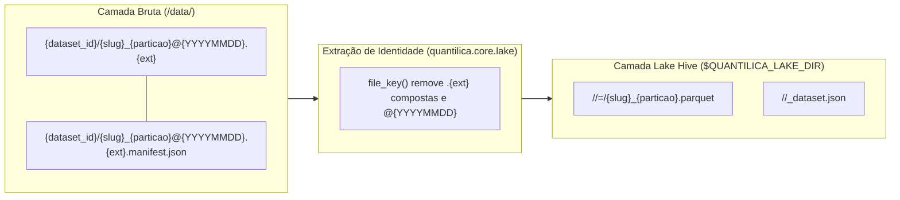

# Convenções de Armazenamento — Fetchers

Esta página cobre a perspectiva do **usuário final**: como os arquivos são nomeados, como as pastas são organizadas e como a flag `-o` funciona. Para a perspectiva do **contribuidor** (como implementar essas convenções num novo fetcher), veja [Padronização de CLI](../normas/cli-fetchers.md).

Este documento define os padrões de nomenclatura de arquivos, estrutura de pastas e interface CLI adotados por todos os pacotes fetcher da Quantilica.

---

## Nomenclatura de Arquivos

O nome de cada arquivo baixado incorpora um timestamp extraído do servidor de origem (cabeçalho `Last-Modified` ou equivalente). A função `stamp_filename()` de `quantilica.core.storage` implementa o padrão.

### Formato

```
{base}@{timestamp}.{ext}
```

O separador entre a base e o timestamp é sempre `@`. A base codifica o conjunto de dados e a partição; o timestamp indica quando o arquivo foi publicado na origem, não quando foi baixado.

### Precisão do timestamp

| Precisão | Formato | Quando usar |
|---|---|---|
| `date` (padrão) | `YYYYMMDD` | Fontes com granularidade diária |
| `datetime` | `YYYYMMDDTHHMMSS` | Fontes com múltiplas versões no mesmo dia |

Quando o servidor não retorna timestamp, o arquivo é salvo sem `@` — sem inventar uma data.

### Exemplos por pacote

| Pacote | Exemplo de nome |
|---|---|
| `comex-fetcher` | `exp_2023@20240315.csv` |
| `datasus-fetcher` | `sih-rd_202001-sp@20240115.dbc` |
| `inmet-fetcher` | `inmet-bdmep_2023@20240101.zip` |
| `pdet-fetcher` | `caged_202001@20210315.7z` |
| `rtn-fetcher` | `rtn@20240315T101500.xlsx` |
| `tesouro-direto-fetcher` | `taxas-dos-titulos-ofertados-pelo-tesouro-direto@20240315T101530.csv` |

### Implementação

```python
from quantilica.core.storage import stamp_filename

# Precisão date (padrão)
stamp_filename("exp_2023", "csv", date(2024, 3, 15))
# → "exp_2023@20240315.csv"

# Precisão datetime
stamp_filename("rtn", "xlsx", datetime(2024, 3, 15, 10, 15), precision="datetime")
# → "rtn@20240315T101500.xlsx"

# Sem timestamp
stamp_filename("rtn", "xlsx", None)
# → "rtn.xlsx"
```

### Gramática canônica de particionamento (`format_partition_token`)

Quando um conjunto de dados é distribuído em múltiplos arquivos por recorte temporal ou geográfico, o nome base (`{base}`) incorpora o token de partição separado do identificador do dataset (`{slug}`) por sublinhado (`_`), construído via `build_stamped_filename()` e `format_partition_token`:

```
{slug}_{partition_token}@{timestamp}.{ext}
```

| Recorte da partição | Gramática do token (`format_partition_token`) | Exemplo de arquivo bruto |
|---|---|---|
| Sem partição (arquivo único) | *(omitido)* | `ncm@20240315.csv` |
| Anual (`year`) | `{year}` (`YYYY`) | `exp_2023@20240315.csv` |
| Mensal (`year`, `month`) | `{year}-{month:02d}` ou `{year}{month:02d}` | `novo-caged_2024-01@20240315.7z` |
| Semestral (`year`, `semester`) | `{year}-{semester:02d}` ou `{year}-S{semester}` | `bpc_2024-01@20240810.csv` |
| Temporal + UF / Região | `{periodo}-{uf_ou_regiao}` (minúsculo) | `sih-rd_202001-sp@20240115.dbc`, `rais-vinculos_2024-sul@20260513.7z` |

### Posicionamento de `@YYYYMMDD` antes de extensões compostas

O carimbo `@YYYYMMDD` (ou `@YYYYMMDDTHHMMSS`) posiciona-se **sempre imediatamente antes da extensão completa do arquivo** — inclusive quando o arquivo possui extensão composta de compressão (como `.csv.gz`, `.tar.gz`, `.json.zst`):

- **Correto**: `cotacoes_2024@20250110.csv.gz` (sidecar: `cotacoes_2024@20250110.csv.gz.manifest.json`)
- **Incorreto**: `cotacoes_2024.csv@20250110.gz`

Na etapa de conversão para o [Lake Hive](../normas/lake.md), a função `file_key()` de `quantilica.core.lake` remove iterativamente todas as extensões brutas da lista canônica (`.gz`, `.csv`, `.zip`, `.7z`, `.tar`, etc.) e, ao final, descarta o sufixo `@YYYYMMDD`, restituindo de forma determinística a chave limpa `cotacoes_2024` para gerar `cotacoes_2024.parquet`.

### Preservação histórica e imutabilidade da camada bruta ("nada se apaga")

Um objetivo central da Quantilica é possibilitar e facilitar o **arquivamento e a preservação histórica de dados públicos brutos**. O padrão `{base}@{timestamp}.{ext}` garante que o diretório bruto funcione como um acervo **imutável e *append-only***:

- **Coexistência de revisões:** quando um órgão público retifica ou republica um arquivo histórico com uma nova data de modificação, o coletor grava um novo arquivo ao lado do existente (ex.: `exp_2023@20240315.csv` e `exp_2023@20240620.csv`), cada um com seu próprio `.manifest.json`. **Nada se apaga e nenhuma revisão anterior é sobrescrita.**
- **Seleção determinística para o Lake (`select_current`):** enquanto a camada bruta preserva todas as safras históricas já publicadas, a função `select_current()` de `quantilica.core.lake` inspeciona as versões disponíveis para cada `file_key()` e elege deterministicamente a revisão vigente (maior `@timestamp`) para alimentar a conversão do Lake Hive.



---

## Estrutura de Pastas

Os arquivos são organizados em pastas diretamente nomeadas pelo `dataset_id`, sem camada intermediária de categoria (sem `raw/`/`processed/`/`docs/`). Esta é a estrutura adotada por todos os fetchers e implementada pelo método `BaseDataRepository.dataset_path()` do `quantilica-core`.

### Princípio

```
{output}/
├── {dataset_id}/
│   ├── {partição}/      ← opcional; usada quando há agrupamento temporal ou geográfico
│   │   └── arquivo@timestamp.ext
│   └── arquivo@timestamp.ext
└── ...
```

O diretório raiz (`{output}`) é o único caminho fornecido pelo usuário. A estrutura interna é de responsabilidade exclusiva do pacote.

### API do quantilica-core

```python
from quantilica.core.storage import BaseDataRepository

class FooRepository(BaseDataRepository):
    def file_path(self, dataset_id: str, filename: str) -> Path:
        return self.dataset_path(dataset_id, filename)
        # → {root}/{dataset_id}/{filename}
```

Categorias adicionais (documentação, dados processados, etc.) são responsabilidade do fetcher — use `self.storage.path_for(...)` diretamente.

### Decisão de subdiretório por ano ou competência (`subdir_by_year=True` vs `False`)

O `DataRepository` (`quantilica.cli.sdk`) suporta duas estratégias para organizar os arquivos dentro de `{output}/{dataset_id}/`:

| Configuração | Layout em disco | Quando adotar | Exemplos |
|---|---|---|---|
| `subdir_by_year=False` *(padrão)* | `{output}/{dataset_id}/{slug}_{particao}@{YYYYMMDD}.{ext}` | Datasets com até algumas centenas de arquivos (partições anuais, semestrais ou mensais nacionais) | `comex-fetcher`, `cvm-fetcher`, `anp-fetcher`, `anac-fetcher`, `tesouro-direto-fetcher` |
| `subdir_by_year=True` | `{output}/{dataset_id}/{ano_ou_competencia}/{slug}_{particao}@{YYYYMMDD}.{ext}` | Datasets massivamente fragmentados (ex.: competência mensal × 27 UFs = 324 arquivos por ano), evitando diretórios planos com dezenas de milhares de inodes | `datasus-fetcher`, `pdet-fetcher` (RAIS/CAGED particionados) |

### Manifesto de proveniência v2 (`DownloadManifest` e `dataset_id`)

Todo arquivo bruto salvo em `{output}/{dataset_id}/` é acompanhado de um arquivo sidecar `{arquivo}.manifest.json` no schema v2 (`MANIFEST_VERSION = 2` de `quantilica.core.manifests`).

O manifesto registra obrigatoriamente o **`dataset_id`** canônico ao lado do `source_id`, permitindo auditoria de proveniência e vinculação direta com o descritor `_dataset.json` do Lake Hive, além dos 5 grupos opcionais de enriquecimento da v2 (`source_meta`, `fingerprint`, `lineage`, `quality` e `execution` — veja a especificação completa em [Proveniência & Manifestos](proveniencia.md#a-anatomia-de-um-manifesto-schema-v2)):

```json
{
  "dataset_id": "exp",
  "fetched_at": "2026-10-20T14:22:10Z",
  "manifest_version": 2,
  "path": "/data/comex/exp/exp_2024@20240315.csv",
  "producer": "comex-fetcher",
  "producer_version": "0.4.0",
  "sha256": "e3b0c44298fc1c149afbf4c8996fb92427ae41e4649b934ca495991b7852b855",
  "size_bytes": 184520910,
  "source_id": "comex",
  "source_meta": {
    "etag": "\"65f41a-2b10c\"",
    "last_modified": "Fri, 15 Mar 2024 12:00:00 GMT"
  },
  "url": "https://balanca.economia.gov.br/balanca/bd/comexstat-bd/ncm/EXP_2024.csv"
}
```

### Exemplos por pacote

**comex-fetcher**
```
{output}/
├── exp/
│   └── exp_2023@20240315.csv
├── imp/
│   └── imp_2023@20240315.csv
├── exp-mun/
├── imp-mun/
├── auxiliary-tables/
│   └── ncm@20240315.csv
├── repetro/
└── validacao/
```

**datasus-fetcher**
```
{output}/
├── sih-rd/
│   ├── 202001/
│   │   └── sih-rd_202001-sp@20240115.dbc
│   └── 202002/
├── sinasc-dn/
│   └── 2023/
│       └── sinasc-dn_2023@20240115.dbc
├── _documentacao/
│   ├── sih/
│   │   └── estrutura@20240115.pdf
│   └── sinasc/
└── _auxiliar/
    └── sih/
        └── cid10@20240115.dbf
```

Documentação e tabelas auxiliares são agrupadas pelo **sistema** (ex: `sih`, `cnes`), não pelo subsistema (ex: `sih-rd`, `cnes-dc`), pois um mesmo conjunto de documentos cobre todos os subsistemas de um sistema. O prefixo `_` faz essas pastas aparecerem antes das pastas de dados em qualquer ordenação alfabética e evita nomes reservados do Windows (como `aux`).

Para a estrutura detalhada de todos os demais pacotes (`inmet-fetcher`, `pdet-fetcher`, `rtn-fetcher`, `tesouro-direto-fetcher`), veja a seção de exemplos em [Padronização de CLI](../normas/cli-fetchers.md).

---

## Interface CLI

A convenção é expor o diretório de saída pelo argumento `-o` / `--output`. Nos fetchers clássicos há um valor padrão `/data/<fonte>`; nos fetchers novos com catálogo declarativo o destino é informado por comando — consulte `quantilica <fonte> --help`.

Para especificações detalhadas sobre a implementação desse argumento, as opções do parser e regras adicionais de interface, consulte o guia de [Padronização de CLI](../normas/cli-fetchers.md).

### Padrões de Diretório por Pacote

Abaixo estão definidos os diretórios de saída padrão (`default` de `--output`) adotados por cada fetcher:

| Pacote | Diretório Padrão (`--output`) |
|---|---|
| `anac-fetcher` | `/data/anac` |
| `anp-fetcher` | `/data/anp` |
| `bcb-sgs-fetcher` | `/data/bcb-sgs` |
| `comex-fetcher` | `/data/comex` |
| `cvm-fetcher` | `/data/cvm` |
| `datasus-fetcher` | `/data/datasus` |
| `inep-fetcher` | `/data/inep` |
| `inmet-fetcher` | `/data/inmet` |
| `pdet-fetcher` | `/data/pdet` |
| `rfb-cnpj-fetcher` | `/data/rfb-cnpj` |
| `rtn-fetcher` | `/data/rtn` |
| `sidra-fetcher` | `/data/sidra` |
| `tesouro-direto-fetcher` | `/data/tesouro-direto` |
| `tse-fetcher` | `/data/tse` |

Os fetchers baseados em `FetcherApp` derivam o padrão do nome do pacote (`/data/<fonte>`). O `-o`/`--output` sobrescreve em qualquer um.

---

*Atualizado em: 28 de setembro de 2026*
