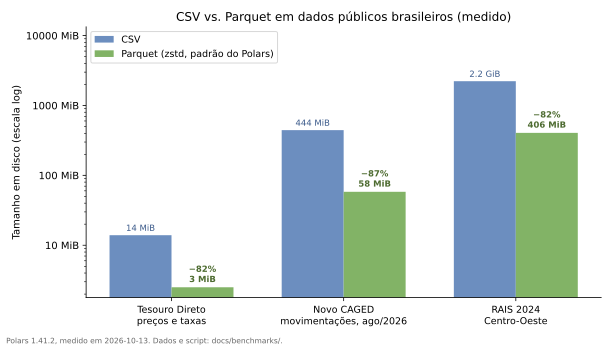
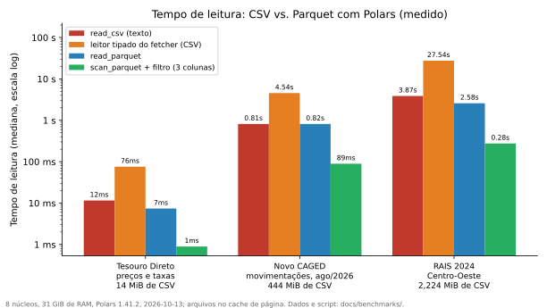

# Parquet + Polars

Tutorial dedicado ao formato (Parquet) e biblioteca (Polars) que formam a espinha do processamento no ecossistema. Os exemplos usam datasets dos três principais domínios — IBGE/SIDRA, RAIS/CAGED e Tesouro Direto — para mostrar que os mesmos padrões servem volumes muito diferentes.

## Por que Parquet?

Datasets brasileiros variam de pequenos (séries macroeconômicas SIDRA: KB) a massivos (RAIS 2024: 12,9 GiB de CSV só em três dos seis arquivos do ano). CSV tem três limitações que aparecem rapidamente:

- carrega arquivo inteiro em memória,
- faz parse de todos os tipos a cada leitura,
- filtragem requer varredura completa.

Parquet contorna todos os três:

- **Armazenamento colunar** — lê apenas as colunas necessárias.
- **Comprimido** — 82% a 87% menor que o CSV equivalente nos dados que medimos.
- **Predicate pushdown** — filtros são aplicados antes da leitura completa.
- **Schema preservado** — sem adivinhação de tipos.

Medido em 2026-10-13 com Polars 1.41.2, nos arquivos oficiais ([dados e scripts](https://github.com/Quantilica/docs/tree/main/benchmarks)). O Parquet é o que `write_parquet` grava por padrão, com compressão `zstd`; com `snappy`, os mesmos dados do CAGED ficam 31% maiores.

| Dataset | CSV | Parquet | Redução |
|---|---|---|---|
| Tesouro Direto, preços e taxas (histórico completo) | 13,9 MiB | 2,5 MiB | 82% |
| Novo CAGED, movimentações de ago/2026 | 443,6 MiB | 58,1 MiB | 87% |
| RAIS 2024, arquivo do Centro-Oeste | 2,2 GiB | 405,5 MiB | 82% |



## Início rápido

### Converter CSV para Parquet

```python
import polars as pl

# RAIS bruto (CSV grande)
df = pl.read_csv("rais_2023.csv")
df.write_parquet("rais_2023.parquet")
# Medido: CSV de 2,2 GiB → Parquet de 405,5 MiB (RAIS 2024, Centro-Oeste)

# Tesouro bruto (CSV pequeno)
df = pl.read_csv("PrecoTaxaTesouroDireto.csv", separator=";")
df.write_parquet("tesouro_precos.parquet")
```

### Ler Parquet

```python
import polars as pl

# Leitura completa
df = pl.read_parquet("rais_2023.parquet")

# Apenas colunas necessárias (mais rápido)
df = pl.read_parquet(
    "rais_2023.parquet",
    columns=["employee_id", "salary", "sector"]
)

# Com filtro pushdown (use scan_parquet para predicate pushdown real)
df = (
    pl.scan_parquet("rais_2023.parquet")
    .filter(pl.col("state") == "SP")
    .collect()
)
```

## Workflows eficientes em memória

### Lazy evaluation: o caso de uso central

`pl.scan_parquet` (lazy) é quase sempre superior a `pl.read_parquet` (eager) para datasets grandes — o otimizador empurra filtros e seleções para a leitura.

```python
import polars as pl

# Pipeline lazy: filtra, seleciona, agrega — tudo otimizado em pass único
query = (
    pl.scan_parquet("rais_2023.parquet")
    .filter(pl.col("state") == "SP")
    .select(["employee_id", "salary", "sector"])
    .group_by("sector")
    .agg(pl.col("salary").mean().alias("avg_salary"))
)

result = query.collect()
# Polars otimiza:
# 1. Empurra filtro state == "SP" para a leitura
# 2. Seleciona colunas cedo (descarta o resto)
# 3. Agrega em pass único
```

### Streaming para volumes maiores que a RAM

```python
import polars as pl

# collect(engine="streaming") processa em chunks — uso baixo de memória
result = (
    pl.scan_parquet("rais_2023.parquet")
    .group_by("state")
    .agg(pl.col("salary").mean())
    .collect(engine="streaming")
)
```

## Tarefas comuns por domínio

### SIDRA: pivotar séries macroeconômicas

```python
import polars as pl

# Após buscar do SIDRA via sidra-fetcher e salvar como Parquet
gdp = pl.read_parquet("gdp_raw.parquet")

# Cast e enriquecimento explícitos
gdp = gdp.with_columns([
    pl.col("V").cast(pl.Float64, strict=False).alias("value"),
    pl.col("D2C").alias("period"),
]).select(["period", "value"])

gdp = gdp.with_columns(
    pl.col("value").pct_change().alias("growth")
)
```

### Tesouro: yield curve por título

```python
import polars as pl
from tesouro_direto_fetcher.constants import Column as C

prices = pl.read_parquet("data/tesouro/precos.parquet")

# Yield médio por título nos últimos 365 dias
yield_curve = (
    prices.lazy()
    .filter(
        pl.col(C.REFERENCE_DATE.value)
        >= pl.col(C.REFERENCE_DATE.value).max() - pl.duration(days=365)
    )
    .group_by(C.BOND_TYPE.value)
    .agg([
        pl.col(C.BUY_YIELD.value).mean().alias("yield_avg"),
        pl.col(C.BUY_PRICE.value).last().alias("preco_atual"),
    ])
    .sort("yield_avg")
    .collect()
)
```

### RAIS: emprego por estado e setor

```python
import polars as pl

df = pl.read_parquet("rais_2023.parquet")

summary = (
    df.group_by(["state", "sector"])
    .agg([
        pl.col("employee_id").count().alias("num_employees"),
        pl.col("salary").mean().alias("avg_salary"),
        pl.col("salary").median().alias("median_salary"),
        pl.col("salary").std().alias("salary_std"),
    ])
    .sort(["state", "sector"])
)

summary.write_parquet("employment_summary.parquet")
```

### Análise temporal multi-ano (RAIS)

```python
import polars as pl

# RAIS é anual (snapshot 31 dez). Combine para tendências:
years = []
for year in range(2021, 2024):
    df = pl.read_parquet(f"rais_{year}.parquet").with_columns(
        pl.lit(year).alias("year")
    )
    years.append(df)

combined = pl.concat(years, how="vertical")

by_year = (
    combined.lazy()
    .group_by(["year", "sector"])
    .agg([
        pl.col("employee_id").count().alias("employment"),
        pl.col("salary").mean().alias("avg_wage"),
    ])
    .sort(["sector", "year"])
    .with_columns([
        pl.col("employment").pct_change().over("sector").alias("employment_growth"),
        pl.col("avg_wage").pct_change().over("sector").alias("wage_growth"),
    ])
    .collect()
)
```

### Top-N: setores que mais empregam

```python
import polars as pl

df = pl.read_parquet("rais_2023.parquet")

top_sectors = (
    df.group_by("sector")
    .agg(pl.col("employee_id").count().alias("employment"))
    .sort("employment", descending=True)
    .head(10)
)
```

### Joins entre fontes (SIDRA × RAIS)

```python
import polars as pl

# PIB trimestral via SIDRA
gdp = pl.read_parquet("gdp.parquet")  # colunas: period, value

# Emprego anual via RAIS — agregado para join
rais = (
    pl.read_parquet("rais_2023.parquet")
    .group_by("state")
    .agg(pl.col("employee_id").count().alias("employment"))
)

# Tabelas externas (CNAE → setor humano)
sectors = pl.read_csv("cnae_sectors.csv")

enriched = rais.join(
    sectors,
    left_on="sector",
    right_on="sector_code",
    how="left",
)
```

## Schema e tipos

### Inspecionar schema

```python
import polars as pl

df = pl.read_parquet("rais_2023.parquet")
print(df.schema)
# {'employee_id': String,
#  'year': Int32,
#  'state': String,
#  'sector': String,
#  'salary': Float64,
#  'tenure_days': Int32}
```

### Cast de tipos

```python
import polars as pl

df = pl.read_parquet("rais_2023.parquet")

# Converter salário para inteiro (economiza espaço se aceitável perder centavos)
df = df.with_columns(pl.col("salary").cast(pl.Int32).alias("salary"))
df.write_parquet("rais_2023_int.parquet")
```

### Colunas computadas

```python
import polars as pl

df = pl.read_parquet("rais_2023.parquet")

df = df.with_columns([
    pl.when(pl.col("tenure_days") < 90).then(pl.lit("< 3 meses"))
    .when(pl.col("tenure_days") < 365).then(pl.lit("3-12 meses"))
    .when(pl.col("tenure_days") < 1825).then(pl.lit("1-5 anos"))
    .otherwise(pl.lit("> 5 anos"))
    .alias("tenure_group")
])
```

## Performance

### CSV vs. Parquet: tempos medidos

Mediana de execuções repetidas, com o arquivo no cache de página do sistema, em 8 núcleos e 31 GiB de RAM, Polars 1.41.2 ([dados e scripts](https://github.com/Quantilica/docs/tree/main/benchmarks)). O "leitor tipado" é o do próprio fetcher (`read_prices`, `read_caged`, `read_rais`), que entrega o DataFrame já com tipos; o Parquet guarda os tipos.

| Dataset | `read_csv` (só texto) | Leitor tipado (CSV) | `read_parquet` | `scan_parquet().filter()` |
|---|---|---|---|---|
| Tesouro Direto (13,9 MiB) | 12 ms | 76 ms | 7 ms | 1 ms |
| Novo CAGED (443,6 MiB) | 0,81 s | 4,54 s | 0,82 s | 89 ms |
| RAIS Centro-Oeste (2,2 GiB) | 3,87 s | 27,54 s | 2,58 s | 0,28 s |

O que a medição mostra:

- **Ler o texto do CSV é rápido no Polars.** No CAGED, `read_csv` sem converter tipos levou 0,81 s, o mesmo que `read_parquet` (0,82 s). O Parquet não ganha por parsear mais rápido, e sim por já guardar os tipos: do CSV ao DataFrame tipado, a leitura foi 5,6× (CAGED) e 10,7× (RAIS) mais lenta que `read_parquet`.
- **Filtro e colunas.** `scan_parquet` com filtro e três colunas foi 9,1× (CAGED) e 9,4× (RAIS) mais rápido que `read_parquet` inteiro, e 51× e 100× mais rápido que o CSV tipado.
- **Polars e pandas no mesmo CSV, lido como texto.** CAGED: 0,81 s contra 11,70 s (14×). Tesouro: 12 ms contra 0,25 s (22×). O arquivo da RAIS não foi medido no pandas.



### Profile suas queries

```python
import time
import polars as pl

df = pl.read_parquet("rais_2023.parquet")

start = time.time()
result = (
    df.filter(pl.col("state") == "SP")
    .group_by("sector")
    .agg(pl.col("salary").mean())
)
print(f"Query levou {time.time() - start:.3f}s")
```

### Particionar arquivos grandes

```python
import polars as pl

df = pl.read_parquet("rais_combined.parquet")

# Escreve particionado por estado — leitura por partição fica trivial
df.write_parquet("rais_partitioned", partition_by="state")

# Lê apenas SP
sp = pl.read_parquet("rais_partitioned/state=SP")
```

## Padrões de produção

### Análise reproduzível com versionamento

```python
from pathlib import Path
from datetime import date
import polars as pl

data_dir = Path("data")
data_dir.mkdir(exist_ok=True)

# Versione com data
filename = data_dir / f"rais_summary_{date.today():%Y_%m_%d}.parquet"

df = pl.read_parquet("rais_2023.parquet")
result = df.group_by("sector").agg(pl.col("salary").mean())
result.write_parquet(filename)
```

### Agregação incremental (CAGED mensal)

```python
from pathlib import Path
import polars as pl

data_dir = Path("caged_data")

# Agrega todos os meses disponíveis
dfs = [pl.read_parquet(p) for p in data_dir.glob("caged_2024_*.parquet")]
combined = pl.concat(dfs)

summary = combined.group_by("state").agg(pl.col("net_flow").sum())
summary.write_parquet("caged_2024_summary.parquet")
```

## Troubleshooting

### Falta de memória em arquivo grande

**Problema:** o arquivo não cabe em RAM.

**Solução:** veja [Streaming para volumes maiores que a RAM](#streaming-para-volumes-maiores-que-a-ram) — `scan_parquet` com `collect(engine="streaming")` resolve o caso mais comum.

### Queries lentas

**Problema:** query mais lenta que o esperado.

**Solução:** veja [Lazy evaluation: o caso de uso central](#lazy-evaluation-o-caso-de-uso-central).

### Tipos errados no Parquet escrito

**Problema:** salário escrito como string em vez de float.

**Solução:** cast explícito antes de escrever.

```python
import polars as pl

df = pl.read_parquet("rais.parquet")
df = df.with_columns(pl.col("salary").cast(pl.Float64))
df.write_parquet("rais_fixed.parquet")
```

---

## Saiba mais

- [Padrões Práticos](padroes.md) — `Parquet em vez de CSV`, `Lazy evaluation`, `Memória para arquivos grandes`.
- [Princípios de Design](principios.md#performance) — por que Parquet é o default do ecossistema.
- [Documentação Polars](https://pola-rs.github.io/) — referência oficial.
