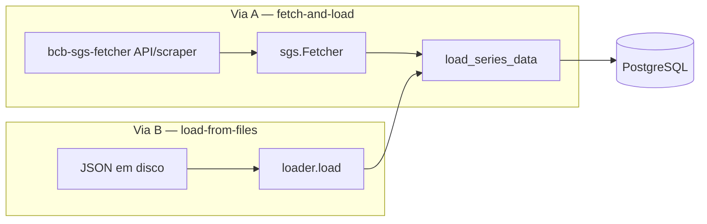
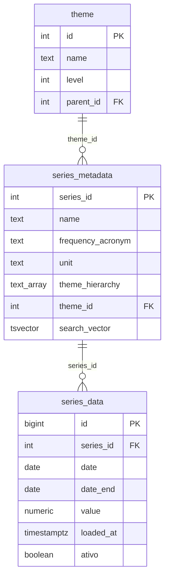

# bcb-sgs-sql

!!! warning "Substituído pelo quantilica-sql"

    Este pacote continua instalável e documentado, mas o motor unificado [quantilica-sql](../../fundacoes/quantilica-sql.md) o substitui. Para novos projetos, comece por ele. A tabela de migração está na página do quantilica-sql.


**Camada de ETL e Data Warehousing para as séries temporais do BCB SGS em PostgreSQL.**

!!! warning "Pegadinhas da fonte e do carregamento"

    - **O BCB revisa valores sem aviso.** Uma observação publicada hoje pode mudar numa próxima divulgação. O `bcb-sgs-sql` usa *soft-versioning* (`ativo`, `loaded_at`) — nunca sobrescreve; insere uma nova revisão e marca a anterior `ativo = FALSE`. A "verdade atual" é `WHERE ativo = TRUE`; a trilha de revisões é `ORDER BY loaded_at`.
    - **Requer PostgreSQL ≥ 15.** O índice único parcial usa `NULLS NOT DISTINCT` para tratar `date_end IS NULL` (séries diárias) como mesma chave. Em versões anteriores seria preciso uma coluna gerada de chave.
    - **Séries diárias têm download retroativo.** A API `/dados` não devolve o histórico completo de alta frequência; o `bcb-sgs-fetcher` faz a varredura ano a ano. Não é o `bcb-sgs-sql` que reimplementa isso — ele apenas passa o acrônimo de frequência.
    - **Metadados exigem scraping com sessão stateful.** O catálogo vem do `ScraperClient` (HTML), que mantém cookies — **não** é seguro paralelizar a coleta de metadados.
    - **`config.ini` lê do CWD.** Rodar de outro diretório falha sem mensagem clara. Use caminho absoluto ou `os.chdir()`.

## O Que É

**`bcb-sgs-sql`** é a infraestrutura de Data Warehousing e ETL para os dados do **SGS**
(Sistema Gerenciador de Séries Temporais) do Banco Central do Brasil. É a camada SQL
análoga ao `sidra-sql` do IBGE.

Enquanto **bcb-sgs-fetcher** resolve o problema de comunicação (obter séries da API JSON e
metadados via scraping), **bcb-sgs-sql** resolve o problema de **persistência, governança
e reprodutibilidade**: converte observações e metadados do SGS em um banco PostgreSQL
relacional, com histórico de revisões preservado.

## Problema que Resolve

Levar séries do SGS para análise rigorosa ou modelagem envolve desafios além do download:

### 1. Catálogo, observações e temas em um modelo coerente

O catálogo do SGS lista 19.607 séries (6.841 desativadas, em 2026-10-13), cada uma com metadados ricos (nome, frequência, unidade,
fonte, hierarquia de temas) e um histórico de observações `(data, valor)`. O `bcb-sgs-sql`
separa isso em quatro tabelas — `series_metadata` (catálogo), `series_data` (observações),
`theme` (hierarquia auto-referente) e `arquivo_carregado` (controle de idempotência) — em vez de achatar tudo num CSV que perde integridade.

### 2. Gargalos de I/O de ingestão

Séries longas (diárias com décadas de histórico) acumulam milhões de observações. Inserção
linha a linha via ORM é lenta e gasta RAM. O motor usa `COPY FROM STDIN` + tabela de
staging.

### 3. Revisões & reprodutibilidade — sem tabela de auditoria

O BCB revisa valores. Sobrescrever destrói a reprodutibilidade. Uma abordagem comum é
manter overwrite mais uma tabela `audit_log` separada para rastrear mudanças. O
`bcb-sgs-sql` adota uma abordagem mais enxuta: **soft-versioning na própria
tabela-fato**, preservando a trilha completa de revisões sem nenhuma tabela de
auditoria separada.

## Arquitetura & Recursos Principais

### 1. Dois caminhos de acoplamento (Via A e Via B)

O pacote serve tanto quem quer buscar-e-carregar num passo só quanto quem já tem os
artefatos em disco:



- **Via A** (`run`, `run-path`): `sgs.Fetcher` envolve o `SgsDataClient` (valores) e o
  `ScraperClient` (metadados), com cache em disco e retry/backoff.
- **Via B** (`load`): lê arquivos JSON de observações e de metadados já em disco — **sem
  rede** — e carrega no banco. Permite usar o pacote 100% sobre artefatos.

Ambas convergem em `database.load_series_data`, então a lógica de soft-versioning vive em
um único lugar.

### 2. Ingestão Streaming (COPY)

- **PostgreSQL `COPY FROM STDIN`**: transmite as observações para uma tabela temporária
  `_staging_series_data`.
- **Single-pass**: como a série temporal é plana (sem dimensões com FK a resolver), não há
  o "Pass 1" de coleta do SIDRA.
- **Stubs de catálogo**: `_ENSURE_SERIES` cria linhas mínimas em `series_metadata` para
  satisfazer a FK numa carga values-only.

### 3. Soft-versioning por detecção-de-mudança (SCD na própria fato)

Auditabilidade sem tabela de auditoria:

- **Nunca sobrescreve**: quando o valor de uma observação muda, insere uma nova linha
  (`ativo = TRUE`, `loaded_at` da execução) e marca a anterior `ativo = FALSE`.
- **Detecção-de-mudança**: só insere/desativa quando o valor **difere** do ativo corrente.
  Recargas idênticas são um no-op (zero churn).
- **Invariante no banco**: um índice único parcial garante no máximo uma linha ativa por
  `(series_id, date, date_end)`.



### 4. Pipelines declarativos via TOML

Lógica de negócio isolada de código, igual ao `sidra-sql`:

```toml
# fetch.toml — quais séries carregar
[[series]]
ids = [433, 13522, 189]          # IPCA mensal, IPCA acum. 12m, IGP-M

[[series]]
themes = ["Índices de preços"]   # filtra o catálogo (exige catálogo já carregado)
frequency = "M"                   # opcional: D, S, M, T, Qd, A
```

### 5. Hierarquia de temas

A `theme_hierarchy` de cada série (ex.: `["Preços", "Índices", "IPCA"]`) é normalizada numa
árvore auto-referente (`theme`) **e** mantida denormalizada como ARRAY (com índice GIN)
para consultas de containment rápidas.

### 6. Arquitetura de plugin

O motor é genérico; os pipelines vivem em repositórios Git separados (ex.:
`bcb-sgs-pipelines`):

```
Plugin (seu repo Git)
├── manifest.toml       ← registro de pipelines
├── precos/ipca/
│   ├── fetch.toml      ← quais séries baixar do SGS
│   ├── transform.toml  ← config da tabela analytics
│   └── ipca.sql        ← consulta wide-pivot
```

```bash
bcb-sgs-sql plugin install https://github.com/Quantilica/bcb-sgs-pipelines.git --alias std
bcb-sgs-sql run std precos
```

### Recursos Adicionais

- ✅ Busca full-text no catálogo (`search_vector` tsvector português + inglês)
- ✅ Cache de metadados (`{id:06d}_basic.json` / `_full.json`, interoperável com o fetcher)
- ✅ Integração PostgreSQL (transações ACID)
- ✅ Operações idempotentes (recarga segura, zero churn)
- ✅ Retry com backoff exponencial (até 5 tentativas)
- ✅ Histórico de revisões via colunas `ativo` + `loaded_at` (sem `audit_log`)

## Instalação

```bash
# Via CLI unificada (recomendado)
quantilica install bcb-sgs-sql

# Ou como biblioteca no seu projeto
uv add bcb-sgs-sql --index https://index.quantilica.com/simple/
```

## Configuração

`bcb-sgs-sql` lê um `config.ini` no diretório de trabalho:

```ini
[storage]
data_dir = data

[database]
user = postgres
password = <senha>
host = localhost
port = 5432
dbname = dados
schema = bcb_sgs
```

Carregue a config em Python:

```python
from bcb_sgs_sql.config import Config

config = Config()  # lê config.ini do diretório atual
```

Ou via CLI:

```bash
bcb-sgs-sql config set database.host     localhost
bcb-sgs-sql config set database.port     5432
bcb-sgs-sql config set database.user     postgres
bcb-sgs-sql config set database.password <senha>
bcb-sgs-sql config set database.dbname   dados
bcb-sgs-sql config set database.schema   bcb_sgs
bcb-sgs-sql config set storage.data_dir  data
```

## Exemplo Rápido: Pipeline ETL

### Opção 1: CLI com plugin (Via A)

Use pipelines pré-construídos de `bcb-sgs-pipelines`:

```bash
# Instalar catálogo padrão
bcb-sgs-sql plugin install https://github.com/Quantilica/bcb-sgs-pipelines.git --alias std

# Executar pipeline (buscar metadados + observações + carregar + transformar)
bcb-sgs-sql run std precos

# Consultar resultados em PostgreSQL
psql -c "SELECT * FROM analytics.precos ORDER BY date DESC LIMIT 12"
```

### Opção 2: Load-from-files (Via B, sem rede)

Carrega artefatos já baixados pelo `bcb-sgs-fetcher`:

```bash
# Detecta automaticamente JSON de observações / metadados
bcb-sgs-sql load ./data/bcb-sgs --kind auto

# Ou explicitamente
bcb-sgs-sql load ./data/bcb-sgs/data --kind json
bcb-sgs-sql load ./data/bcb-sgs/metadata --kind metadata
```

### Opção 3: TOML declarativo

Define o fetch:

```toml
# pipelines/precos/fetch.toml
[[series]]
ids = [433, 13522, 189]
```

Define a transform (wide-pivot — uma coluna por série):

```toml
# pipelines/precos/transform.toml
[[table]]
name = "precos"
schema = "analytics"
strategy = "replace"
sql = "precos.sql"
```

```sql
-- pipelines/precos/precos.sql
SELECT
    sd.date,
    MAX(CASE WHEN sd.series_id = 433   THEN sd.value END) AS ipca_mensal,
    MAX(CASE WHEN sd.series_id = 13522 THEN sd.value END) AS ipca_acum_12m,
    MAX(CASE WHEN sd.series_id = 189   THEN sd.value END) AS igpm_mensal
FROM series_data sd
WHERE sd.series_id IN (433, 13522, 189)
  AND sd.ativo = TRUE
GROUP BY sd.date
ORDER BY sd.date;
```

Execute:

```python
from pathlib import Path
from bcb_sgs_sql.config import Config
from bcb_sgs_sql.toml_runner import TomlScript
from bcb_sgs_sql.transform_runner import TransformRunner

config = Config()

# Extract + Load (metadados → observações → banco)
TomlScript(config, Path("pipelines/precos/fetch.toml")).run()

# Transform (SQL → schema analytics)
TransformRunner(config, Path("pipelines/precos/transform.toml")).run()
```

### Opção 4: ETL programático

```python
from bcb_sgs_sql.config import Config
from bcb_sgs_sql import database, sgs

config = Config()
engine = database.get_engine(config)
database.create_all(engine, config.db_schema)

with sgs.Fetcher(config.data_dir, max_workers=4) as fetcher:
    series_ids = [433, 13522]

    # 1. Metadados (catálogo + temas)
    rows = []
    freq_by_id = {}
    for sid in series_ids:
        basic, full = fetcher.fetch_metadata(sid)
        with engine.begin() as conn:
            theme_id = database.upsert_theme_hierarchy(
                conn, basic.theme_hierarchy
            )
        # ... mapear para linha de catálogo (ver loader.basic_to_metadata_row)

    # 2. Observações
    points = fetcher.download_series(series_ids, frequency_by_id=freq_by_id)

# 3. Carregar (soft-versioned)
rows = [(p.series_id, p.date, p.date_end, p.value) for p in points]
database.load_series_data(engine, rows)
```

## Referência

Governança de dados e revisões, ingestão streaming, referência de API, formato de pipeline TOML, schema, performance, boas práticas e resolução de problemas estão em [bcb-sgs-sql — referência](bcb-sgs-sql/referencia.md).

---

## Saiba Mais

- [Visão Geral BCB](index.md)
- [bcb-sgs-fetcher](bcb-sgs-fetcher.md) — Ferramenta de extração de séries
- [sidra-sql](../ibge/sidra-sql.md) — O análogo para o IBGE/SIDRA
- [Princípios de Design](../../conceitos/principios.md)
- [SGS — Sistema Gerenciador de Séries Temporais](https://www3.bcb.gov.br/sgspub/)
- [Documentação PostgreSQL](https://www.postgresql.org/docs/)
