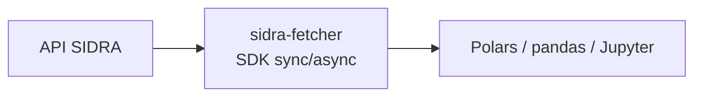
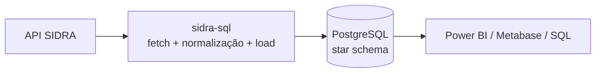

# IBGE — Macroeconomia

Você precisa do IPCA mensal desde 1994. O portal do IBGE te entrega uma URL como `/t/1737/n1/all/v/allxp/p/last%201/c81/0/d/m` — e no meio da série histórica, um `502` sem explicação. Bem-vindo ao SIDRA: o sistema central das estatísticas oficiais do país — PIB, inflação, emprego, demografia — milhares de séries temporais atrás da API mais rica e mais instável do Brasil.

## O desafio

SIDRA é a fonte mais rica do Brasil, mas consumi-la em escala enfrenta três obstáculos:

- **Instabilidade de rede** — servidores governamentais sofrem rate limiting e downtime; HTTP 429/500 são frequentes; timeouts exigem backoff.
- **Complexidade paramétrica** — a API usa URLs crípticas, codificadas por prefixos de letra (`/t/1620/n1/all/v/116/p/all/d/m`); construção manual é frágil.
- **Escala** — mais de 9 mil tabelas (agregados); algumas séries cobrem 50+ anos com granularidade mensal/diária; classificações aninhadas; documentação espalhada em português.

## Dois stacks: Exploração vs. Produção

O ecossistema fornece **dois stacks complementares** para SIDRA — escolha baseado em maturidade do pipeline e requisitos.

!!! note "Motor SQL unificado"

    O stack de produção (`sidra-sql` e `sidra-pipelines`) tem substituto: o [quantilica-sql](../../fundacoes/quantilica-sql.md) e o [quantilica-pipelines](../../fundacoes/quantilica-pipelines.md). Os pacotes legados seguem documentados abaixo.

### Stack 1 — Exploração (`sidra-fetcher`)

Para análise ad-hoc, notebooks Jupyter, lógica customizada e fetching on-demand. SDK Python com clientes sync (`SidraClient`) e async (`AsyncSidraClient`).

### Stack 2 — Produção (legado: `sidra-sql` + `sidra-pipelines`)

Para pipelines automatizados, data warehouses multi-usuário e definições declarativas. Motor ETL baseado em plugins que ingere SIDRA num star schema PostgreSQL com bulk load `COPY FROM STDIN` (400k+ rows/s) e SCD Type II para preservar revisões históricas.

| Dimensão | Stack 1 | Stack 2 |
|---|---|---|
| Setup | minutos (`quantilica install`) | ~30 min (PostgreSQL + config) |
| Frequência | on-demand | horária / diária / semanal |
| Escala | uso pessoal, notebooks | multi-usuário, enterprise |
| Validação | manual | automatizada (constraints) |
| Auditoria | logging básico | SCD Type II completo |
| Transformação | Python (Polars) | SQL declarativo |

## Pacotes

- **[sidra-fetcher](sidra-fetcher.md)** — SDK sync/async para extração robusta, com smart caching via `Last-Modified`, classe `Parametro` para abstração de URL, e tipagem forte de metadados.
- **[sidra-sql](sidra-sql.md)** (legado, substituído pelo [quantilica-sql](../../fundacoes/quantilica-sql.md)) — motor ETL com plugins TOML (`fetch.toml` + `transform.toml` + `transform.sql`), bulk load `COPY`, schema relacional 5-tabelas, SCD Type II.
- **[sidra-pipelines](sidra-pipelines.md)** (legado, substituído pelo [quantilica-pipelines](../../fundacoes/quantilica-pipelines.md)) — catálogo pré-construído de pipelines production-ready (PIB, IPCA, população, agricultura). Deploy one-command via `sidra-sql run std <pipeline>`.

Os [Princípios de Design](../../conceitos/principios.md) do ecossistema — Resiliência, Performance, Reprodutibilidade, Sem Mágica — se aplicam diretamente aqui. Receitas táticas em [Padrões Práticos](../../conceitos/padroes.md): [Concorrência para I/O](../../conceitos/padroes.md#concorrencia-io), [Auto-retry](../../conceitos/padroes.md#auto-retry).

## Próximos passos

- Para análise rápida em notebook: vá para **[sidra-fetcher](sidra-fetcher.md)**.
- Para data warehouse PostgreSQL: vá para **[quantilica-sql](../../fundacoes/quantilica-sql.md)** + **[quantilica-pipelines](../../fundacoes/quantilica-pipelines.md)**. A documentação dos pacotes legados está em [sidra-sql](sidra-sql.md) e [sidra-pipelines](sidra-pipelines.md).
- Para combinar IBGE com outras fontes: veja a receita **[Análise Econômica Multi-Fonte](../../guias/receitas/analise-economica-multi-fonte.md)**.

## Recursos externos

- [Site oficial IBGE](https://www.ibge.gov.br/)
- [Banco SIDRA](https://sidra.ibge.gov.br/)
