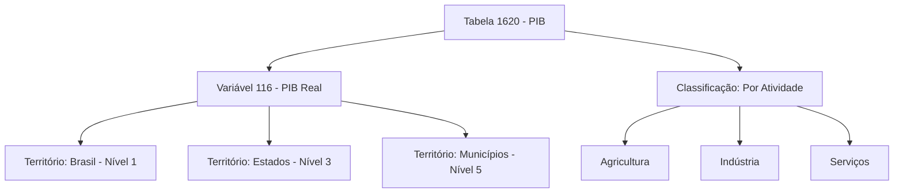
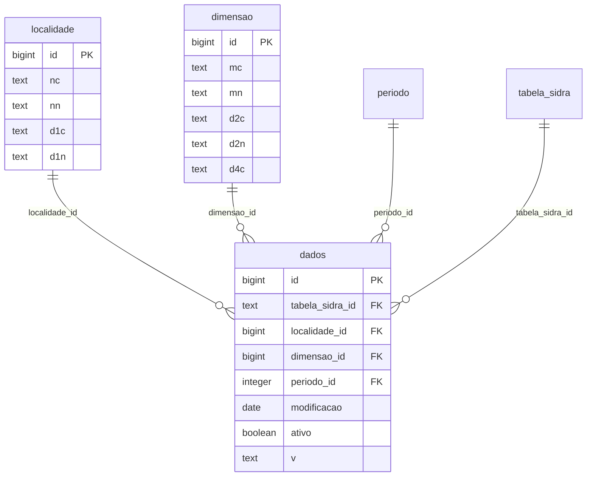

# sidra-sql

!!! warning "Substituído pelo quantilica-sql"

    Este pacote está depreciado e o repositório foi arquivado (somente leitura). As versões já publicadas continuam instaláveis pelo índice e esta página segue como referência, mas o motor unificado [quantilica-sql](../../fundacoes/quantilica-sql.md) o substitui. Para novos projetos, comece por ele. A tabela de migração está na página do quantilica-sql.


**Infraestrutura avançada de ETL e Data Warehousing para dados SIDRA do IBGE.**

!!! warning "Pegadinhas da fonte oficial"

    - **O IBGE revisa dados sem aviso.** PIB Q3 2020 publicado em janeiro de 2021 pode estar diferente em 2026. O `sidra-sql` usa SCD Type II (`ativo`, `modificacao`) — nunca sobrescreve, sempre acrescenta. Queries com `WHERE modificacao <= 'YYYY-MM-DD' AND ativo = TRUE` reproduzem qualquer snapshot histórico.
    - **Códigos de tabela são strings.** `"1620"`, não `1620`. Inteiro causa `404` silencioso.
    - **`unnest_classifications = true` é uma arma carregada.** Tabelas com 6 classificações fazem cross-product explosivo. Comece com `false` e expanda só quando souber o volume.
    - **`INSERT` linha-a-linha leva horas.** O motor usa `COPY FROM STDIN` + tabela de staging. Não tente "otimizar" via SQLAlchemy ORM.
    - **Períodos têm formatos heterogêneos.** Mensal `202301`, trimestral `202301`, anual `2023`, plurianual `2020-2023`. A dimensão `periodo` já normaliza com `ano`, `mes`, `trimestre`, `data_inicio`, `data_fim` — joine pela coluna que faz sentido.
    - **`config.ini` lê do CWD.** Se você roda de outro diretório, `Config()` levanta um `ConfigError` com as instruções de configuração. Use `os.chdir()` ou o config global (`config set --global`).


## O Que É

**`sidra-sql`** é uma infraestrutura completa de Data Warehousing e ETL (Extração, Transformação, Carregamento) projetada para ingerir, estruturar e versionarizare dados extraídos do SIDRA.

Enquanto **sidra-fetcher** resolve o problema de comunicação (obter dados da API), **sidra-sql** resolve o problema de **governança, persistência e reprodutibilidade**. Converte dados IBGE brutos e hierárquicos em um banco de dados relacional PostgreSQL otimizado para consultas analíticas pesadas.

## Problema que Resolve

Trabalhar com dados IBGE para pesquisa rigorosa ou modelagem financeira envolve desafios estruturais além do simples download:

### 1. Ontologia Complexa do IBGE

SIDRA organiza dados em estruturas altamente aninhadas:

- **Agregados** (tabelas) contêm **variáveis** em múltiplos **níveis territoriais**
- Até **6 classificações diferentes** podem se cruzar
- Achatar isso em arquivos CSV destrói **integridade referencial** e causa duplicação massiva

Estrutura SIDRA (hierárquica):



Problema: Como representar isso em um CSV flat sem duplicação?

### 2. Gargalos de I/O de Ingestão

Salvar dezenas de milhões de linhas usando métodos tradicionais (inserção ORM linha por linha) pode levar **horas** e esgotar RAM.

### 3. Revisões & Reprodutibilidade

O IBGE frequentemente revisa dados históricos. Simplesmente substituir dados antigos por novos destrói a reprodutibilidade de pesquisa acadêmica ou modelos de ML treinados em "snapshots históricos."

**sidra-sql** resolve todos os três com arquitetura sênior de Data Engineering:

## Architecture & Recursos Principais

### 1. Ingestão Streaming (Performance "Gold Standard")

Para volumes massivos de dados sem exaustão de memória:

- **Estratégia Two-Pass**: Primeiro pass resolve dimensões e chaves estrangeiras; segundo pass faz bulk load
- **PostgreSQL COPY FROM STDIN**: Protocolo binário nativo transmite milhões de registros em segundos
- **Upsert Atômico**: Usa `ON CONFLICT DO NOTHING` para deduplicação
- **Tabelas de Staging**: Tabela temporária `_staging_dados` para operações atômicas

**Performance**: o `COPY` em lote evita o custo de um `INSERT` por linha.

### 2. Star Schema Dimensional

Modelagem relacional estrita separa metadados de fatos:

**Tabelas de Dimensão:**

- `tabela_sidra`: Metadados brutos em formato `JSONB` (preserva estrutura IBGE)
- `localidade`: Malha territorial (Brasil, estados, municípios, regiões)
- `periodo`: Dimensão de tempo com níveis apropriados de agregação
- `dimensao`: Cruzamentos de classificações (categorias × variáveis)

**Tabela de Fatos (`dados`):**

- Extremamente enxuta: Apenas chaves estrangeiras, data de modificação, flag de versão, valor
- Constraint unique composto previne duplicatas
- Otimizada para consultas analíticas (workloads OLAP)



### 3. Dimensões que Mudam Lentamente (SCD Type II)

Auditabilidade para ambientes de pesquisa e regulatória:

- **Nunca deletar**: Quando IBGE revisa dados históricos, inserir nova versão + marcar antiga como `ativo = FALSE`
- **Histórico completo preservado**: Saber exatamente como o banco de dados estava em qualquer data passada
- **Colunas**: `modificacao` (data), `ativo` (flag booleano)

**Caso de uso acadêmico**: Reproduzir pesquisa de 2015 exatamente com dados de 2015, mesmo se 2026 tem correções

### 4. Pipelines Declarativos via TOML

Lógica de negócio isolada de código:

```toml
# fetch.toml - Definir pipelines sem codificar
[[tabelas]]
tabela_sidra = "1620"
variables = ["116"]                    # Variável PIB
territories = {1 = []}                 # nível 1 (Brasil)

[[tabelas]]
tabela_sidra = "1737"
variables = ["63"]                     # Inflação IPCA
territories = {1 = [], 3 = []}        # Níveis 1 & 3
```

### 5. Explosão Automática de Classificações

A diretiva `unnest_classifications = true` dispara algoritmo recursivo:

- Mapeia todos os cross-produtos variável × categoria automaticamente
- Elimina descoberta manual de ID
- Gera consultas dimensionais otimizadas

### 6. Arquitetura de Plugin

O motor é leve e genérico; definições de dados vivem em repositórios Git separados:

```
Plugin (seu repo Git)
├── manifest.toml       ← registro de pipeline
├── pipeline-a/
│   ├── fetch.toml      ← o que baixar do SIDRA
│   ├── transform.toml  ← config de tabela analytics
│   └── transform.sql   ← consulta de desnormalização
```

Instalar e executar:

```bash
sidra-sql plugin install https://github.com/Quantilica/sidra-pipelines.git --alias std
sidra-sql run std pib_municipal
```

### Recursos Adicionais

- ✅ Metadados SIDRA armazenados em JSONB
- ✅ Cache de metadados para performance (arquivos JSON locais)
- ✅ Integração PostgreSQL (transações ACID)
- ✅ Operações idempotentes (re-execução segura)
- ✅ Lógica de retry com backoff exponencial (até 5 tentativas)
- ✅ Trilhas de auditoria via colunas `ativo` + `modificacao`

## Instalação

```bash
# Via CLI unificada (recomendado)
quantilica install sidra-sql

# Ou como biblioteca no seu projeto
uv add sidra-sql --index https://index.quantilica.com/simple/
```

## Configuração

sidra-sql lê um arquivo `config.ini` no diretório de trabalho:

```ini
[storage]
data_dir = data

[database]
user = postgres
password = <senha>
host = localhost
port = 5432
dbname = dados
schema = ibge_sidra
```

Carregue a config em Python:

```python
from sidra_sql.config import Config

config = Config()  # lê config.ini do diretório atual
```

## Exemplo Rápido: Pipeline ETL

### Opção 1: CLI (Recomendado)

Use pipelines padrão pré-construídos de [sidra-pipelines](sidra-pipelines.md):

```bash
# Instalar catálogo padrão
sidra-sql plugin install https://github.com/Quantilica/sidra-pipelines.git --alias std

# Executar pipeline (baixar + carregar + transformar)
sidra-sql run std pib_municipal

# Consultar resultados em PostgreSQL
psql -c "SELECT * FROM analytics.pib_municipal WHERE ano >= 2020"
```

### Opção 2: TOML Declarativo (Recomendado para pipelines customizados)

Define a fetch pipeline:

```toml
# pipelines/economic/fetch.toml
[[tabelas]]
tabela_sidra = "1620"
variables = ["116"]
territories = {6 = []}
unnest_classifications = true

[[tabelas]]
tabela_sidra = "1737"
variables = ["63"]
territories = {1 = [], 3 = []}
```

Define a transform:

```toml
# pipelines/economic/transform.toml
[[table]]
name = "economic_indicators"
schema = "analytics"
strategy = "replace"
sql = "transform.sql"
```

```sql
-- pipelines/economic/transform.sql
SELECT
    l.d1n  AS territory,
    p.codigo AS period,
    d.d2n  AS variable,
    r.v    AS value
FROM ibge_sidra.dados r
JOIN ibge_sidra.localidade l ON r.localidade_id = l.id
JOIN ibge_sidra.periodo    p ON r.periodo_id    = p.id
JOIN ibge_sidra.dimensao   d ON r.dimensao_id   = d.id
WHERE r.ativo = TRUE
```

Execute o pipeline:

```python
from pathlib import Path
from sidra_sql.config import Config
from sidra_sql.toml_runner import TomlScript
from sidra_sql.transform_runner import TransformRunner

config = Config()

# Extract + Load
TomlScript(config, Path("pipelines/economic/fetch.toml")).run()

# Transform (SQL → analytics schema)
TransformRunner(config, Path("pipelines/economic/transform.toml")).run()
```

### Opção 3: ETL Programático

Controle total sobre cada fase:

```python
from sidra_sql.config import Config
from sidra_sql.sidra import Fetcher
from sidra_sql.storage import Storage
from sidra_sql.database import get_engine, save_agregado, load_dados

config = Config()
engine = get_engine(config)
storage = Storage.default(config)

with Fetcher(config, storage=storage, max_workers=4) as fetcher:
    # 1. BUSCAR metadados (territórios, períodos, classificações)
    metadata = fetcher.fetch_metadata("1620")
    save_agregado(engine, metadata)

    # 2. PLANEJAR e BAIXAR arquivos de dados para armazenamento local
    plan = [
        (None, parametro, modificacao)
        for parametro, modificacao in fetcher.plan_periods(
            tabela_sidra="1620",
            territories={"1": []},  # nível 1 (Brasil)
            variables=["116"],
        )
    ]
    data_files = fetcher.download_periods(plan)

# 3. CARREGAR em PostgreSQL via COPY FROM STDIN
load_dados(engine, storage, data_files)
```

## Referência

Governança de dados e revisões, ingestão streaming, referência de API, formato de pipeline TOML, schema, performance, boas práticas e resolução de problemas estão em [sidra-sql — referência](sidra-sql/referencia.md).

---

## Saiba Mais

- [Visão Geral IBGE](index.md)
- [sidra-fetcher](sidra-fetcher.md) — Ferramenta de extração de dados
- [sidra-pipelines](sidra-pipelines.md) — Catálogo de pipelines padrão
- [Princípios de Design](../../conceitos/principios.md)
- [Banco de Dados SIDRA (Português)](https://sidra.ibge.gov.br/)
- [Documentação PostgreSQL](https://www.postgresql.org/docs/)
