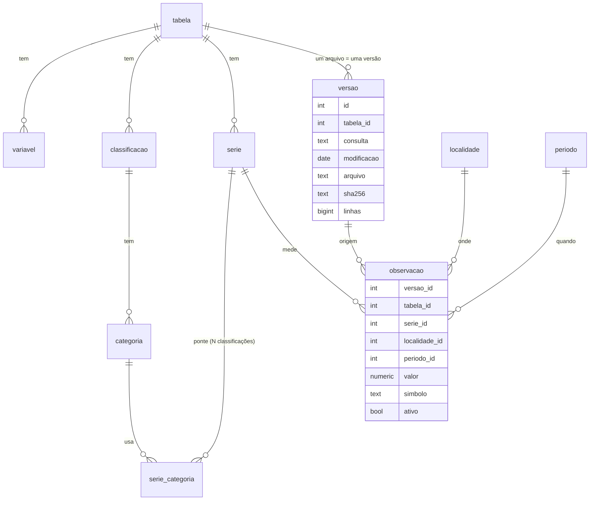

# `quantilica-sql`

O `quantilica-sql` é o motor SQL do ecossistema. Ele carrega os arquivos baixados pelos coletores em schemas dedicados do PostgreSQL, sem repetir cargas já feitas, e executa pipelines declarativos que materializam tabelas e views na camada `analytics`.

Ele **substitui** os motores `sidra-sql` e `bcb-sgs-sql`, que seguem documentados e funcionando enquanto você migra. Os pipelines vêm do catálogo [`quantilica-pipelines`](quantilica-pipelines.md).

| | |
|---|---|
| **Versão** | 0.4.1 |
| **Banco** | PostgreSQL (driver `psycopg` 3, carga por `COPY`) |
| **Fontes** | 15 adaptadores: ANAC, ANP, B3, BCB-SGS, Comex, CVM, DATASUS, INEP, INMET, PDET, RFB-CNPJ, RTN, SIDRA, Tesouro Direto e TSE |
| **Distribuição** | índice da Quantilica (não está no PyPI) |

!!! note "Escopo"

    O `quantilica-sql` **não baixa** dados. Baixe com o coletor da fonte (`quantilica <fonte> sync`) e aponte a carga para o diretório baixado. A separação mantém os coletores leves e a carga em banco opcional.

## Instalação

```bash
# Via CLI unificada (recomendado)
quantilica install sql

# Ou como biblioteca no seu projeto
uv add quantilica-sql --index https://index.quantilica.com/simple/
```

O extra `analysis` (Polars e PyArrow) só é necessário para a carga de alguns arquivos grandes, como os ZIPs da RFB-CNPJ:

```bash
uv add 'quantilica-sql[analysis]' --index https://index.quantilica.com/simple/
```

**Requisitos:** Python 3.12+ e um PostgreSQL acessível.

## Configuração

A conexão vem da variável de ambiente `DATABASE_URL`. Sem ela, o padrão é `postgresql://postgres@localhost:5432/dados`.

```bash
export DATABASE_URL='postgresql://<usuario>:<senha>@localhost:5432/dados'
```

Outras variáveis: `QUANTILICA_STORAGE_ROOT` (raiz dos dados baixados, padrão `./data`) e `QUANTILICA_STAGING_DIR` (diretório para staging de arquivos grandes, padrão o diretório temporário do sistema).

## Primeiro uso

```bash
# 1. Baixar com o coletor
quantilica cvm sync cia-cad -o ./data/cvm

# 2. Carregar no PostgreSQL
quantilica sql load cvm -s ./data/cvm

# 3. Ver o que foi carregado
quantilica sql status
```

Rodar o `load` de novo não duplica nada: cada arquivo carregado fica registrado em `{schema}.arquivo_carregado` com o `sha256` do conteúdo. Arquivo igual é pulado; o mesmo nome com conteúdo novo é recarregado; `--force` refaz a carga mesmo assim.

## Comandos

| Comando | O que faz |
|---|---|
| `quantilica sql status` | Mostra schemas, tamanhos e tabelas no PostgreSQL |
| `quantilica sql load <domínio>` | Carrega uma fonte. `-s` caminho dos arquivos, `-c` competência (`AAAA-MM` ou lista), `-a` todas as partições, `-t` filtra tabela ou grupo, `--tablespace`, `--staging-dir`, `-f` força recarga. No SIDRA, também `--historico` e `--recriar` ([abaixo](#sidra-ibge_sidra)) |
| `quantilica sql run <pipeline>` | Executa um pipeline de transformação na camada `analytics`. `--raw-schema` e `--target-schema` ajustam os schemas |
| `quantilica sql scaffold <nome>` | Gera o esqueleto de um pipeline (`-t ibge`, `bcb` ou `general`) ou de um catálogo (`--catalog`) |
| `quantilica sql plugin install\|list\|remove` | Gerencia catálogos de pipelines instalados via Git |
| `quantilica sql tablespaces` | Lista as tablespaces da instância |
| `quantilica sql maintenance` | Tarefas de manutenção e índices |

**Pasta e `--all`.** `-s` aceita um arquivo ou uma pasta. No `sidra` e no `bcb`, a pasta é a raiz do bruto (`t-<id>/...` ou `data/...`) e exige `--all` (todas as tabelas ou séries) ou `-t <id>` (uma); só a versão vigente de cada consulta (carimbo mais novo do nome) é carregada. Os detalhes de cada fonte estão nas seções [SIDRA](#sidra-ibge_sidra) e [BCB SGS](#bcb-sgs-bcb_sgs).

Domínios aceitos em `load`: `anac`, `anp`, `b3`, `bcb`, `bcb-sgs`, `comex`, `cvm`, `datasus`, `inep`, `inmet`, `pdet`, `rfb`, `rfb-cnpj`, `rtn`, `secex-comex` (alias legado de `comex`), `sidra`, `tddata`, `tesouro-direto`, `tesouro_direto` e `tse`.

Fora da CLI unificada, o mesmo conjunto de comandos está disponível como `quantilica-sql` (útil em scripts, agendadores e contêineres).

## Como funciona

- **Um schema por fonte:** `anp`, `bcb_sgs`, `cvm`, `inmet`, `pdet`, `rfb_cnpj`, `ibge_sidra` e assim por diante.
- **Camada analítica:** o schema `analytics` guarda as tabelas e views produzidas pelos pipelines.
- **Cargas idempotentes:** `{schema}.arquivo_carregado` registra o que já entrou. Rodar duas vezes é seguro.
- **`COPY` em streaming:** a carga usa `COPY` com `psycopg` 3, sem montar o arquivo inteiro em memória.
- **Partições:** tabelas grandes são particionadas por mês ou por ano.
- **Adaptadores:** cada fonte tem um adaptador que sabe localizar os arquivos, criar as tabelas e carregar. Um motor genérico cobre o que é comum entre eles.

## SIDRA (`ibge_sidra`)

O adaptador `sidra` lê os arquivos do `ibge-sidra-fetcher` (`t-<id>/t-<id>_...@AAAAMMDD.json`, com o sidecar `.manifest.json` e o `metadados@AAAAMMDD.json` da tabela) e grava um modelo estrela em formato longo. Qualquer tabela do SIDRA carrega, com qualquer número de dimensões e de classificações.

```bash
# bruto coletado: <raiz>/t-1737/..., <raiz>/t-7060/...
quantilica sql load sidra --source-path <raiz-do-bruto> --all          # só a versão vigente de cada consulta
quantilica sql load sidra --source-path <raiz-do-bruto> --table 7060   # uma tabela
quantilica sql load sidra --source-path <raiz-do-bruto> --all --historico  # todas as versões, da mais antiga para a mais nova
```

### O modelo



A **série** concentra a variável, a unidade e a combinação de categorias das classificações; a ponte para as N classificações fica nela, não no fato (uma tabela municipal grande tem dezenas de milhões de observações e poucas centenas ou milhares de séries). O fato custa cerca de 100 bytes por linha com o índice único, e a carga roda a cerca de 100 mil linhas por segundo em PostgreSQL local. Exige **PostgreSQL 12+** (colunas geradas).

### O papel de cada dimensão vem da fonte

O SIDRA numera `D1..Dn` na ordem dos segmentos da URL da consulta, e não pela tabela: a mesma tabela devolve o período em `D2` ou em `D1` conforme a ordem pedida. Por isso o adaptador **nunca assume a posição**. O papel de cada dimensão (território, variável, período, classificação) sai da URL gravada no sidecar e, de forma independente, do cabeçalho do arquivo conferido com os metadados da tabela; as duas leituras têm de concordar. Divergência, dimensão sem papel e falta do sidecar e dos metadados interrompem a carga do arquivo, com o nome dele e o motivo. A regra foi testada com a mesma tabela em quatro ordens de URL.

### Valores e símbolos

`V` numérico vira `numeric` com a escala do texto (`7695.8200000000000` volta idêntico). Os símbolos do IBGE (`-`, `..`, `...`, `X`, `Z`) vão para `simbolo`, com `valor` nulo: nunca viram `0`. Zero numérico do IBGE (`0`, `0.0`) é `valor = 0`.

### Revisões e vigência

Cada arquivo é uma **versão** (`ibge_sidra.versao`): a consulta, a data de modificação do período na fonte (`modificacao`), o `sha256` e o número de linhas. Uma revisão do IBGE chega como arquivo novo (`@data_nova`) ao lado do antigo; a carga insere a versão nova e **não apaga** a antiga. Só uma observação por célula é `ativo`:

- cada consulta afirma o que traz a sua última versão: uma célula que a revisão deixou de trazer sai da vigência e continua no banco como história;
- entre consultas diferentes que cobrem a mesma célula, vale a de maior data de modificação (empate: a primeira carregada, com aviso se o valor diferir);
- o estado ativo **não depende da ordem de carga** nem de `--all` contra `--historico`;
- uma versão sem nenhuma célula, ou que perde mais de 50% das células da versão anterior da mesma consulta, é recusada (uma resposta cortada não apaga a vigência); `--force` carrega mesmo assim.

Isto **não é** o SCD Type II do `sidra-sql`: não há `valido_de`/`valido_ate` por linha nem diff valor a valor; a versão é o arquivo e a vigência é derivada. A tabela abaixo resume as diferenças.

### Consulta no tempo: `dados_em`

A função `ibge_sidra.dados_em(data[, tabela])` devolve o que valia numa data, com as mesmas colunas de `dados`:

```sql
-- PIB municipal como estava no IBGE em 15/12/2019
SELECT l.d1c AS municipio, p.ano, d.v::numeric AS valor
FROM ibge_sidra.dados_em(DATE '2019-12-15', '5938') d
JOIN ibge_sidra.localidade l ON d.localidade_id = l.id
JOIN ibge_sidra.periodo p ON d.periodo_id = p.id
JOIN ibge_sidra.dimensao dim ON d.dimensao_id = dim.id
WHERE dim.d2n = 'Produto Interno Bruto a preços correntes';
```

Para cada célula vale a versão mais recente com `modificacao <= data`, e para a data de hoje o resultado é igual a `dados WHERE ativo`. Uma célula removida por uma revisão não volta; versão sem data não entra. Passe a tabela (`'5938'`) sempre que souber: sem ela a função percorre o fato inteiro.

!!! warning "Não combine `modificacao <= data` com `ativo = TRUE`"

    Era a receita do `sidra-sql`, mas está errada: `ativo` marca só a versão vigente **hoje**. Uma chave revisada depois de `data` tem a versão que valia em `data` inativa, e o filtro a descarta em vez de devolvê-la. Use `dados_em`.

O histórico só existe no banco se as versões antigas estiverem no bruto (o coletor nunca apaga uma versão) e forem carregadas: `--all --historico` reconstrói a história a partir do bruto; sem `--historico` ela passa a acumular a partir das revisões seguintes.

### Superfície para consultas

| Objeto | O que é |
|---|---|
| `dados` (view) | uma linha por célula: `tabela_sidra_id`, `localidade_id`, `dimensao_id`, `periodo_id`, `modificacao`, `ativo` e `v` (texto do valor ou do símbolo) |
| `localidade`, `periodo` | `localidade` com `nc`, `nn` (nível), `d1c`, `d1n` (código e nome); `periodo` com `ano`, `mes`, `trimestre`, `frequencia`, `data_inicio` |
| `dimensao` (view) | uma linha por série: `mc`, `mn` (unidade), `d2c`, `d2n` (variável), `d4c`..`d9n` (até 6 classificações, na ordem dos metadados) |
| `observacao_plana` (view) | os nomes, com as categorias em JSONB, sem JOIN |
| `dados_em(data[, tabela])` | o que valia numa data |

`dados`, `dimensao`, `localidade` e `periodo` são os nomes das consultas do catálogo [`quantilica-pipelines`](quantilica-pipelines.md): as SQL de `ibge/**` leem essa superfície sem mudança.

### Esquema da versão 0.3.x

A versão 0.3.x guardava só uma tabela `dados` com os códigos crus (a "dimensão" era o código da variável e as classificações eram descartadas). Esse esquema não se converte: a primeira carga num schema antigo sai com código 1 e uma mensagem. `quantilica sql load sidra ... --recriar` renomeia a tabela antiga para `dados_legado_v0`, apaga do ledger as linhas do SIDRA e cria o esquema novo, sem migrar dados; recarregue o bruto em seguida.

## BCB SGS (`bcb_sgs`)

```bash
# bruto do bcb-sgs-fetcher:
#   <raiz>/data/series_<id>@AAAAMMDDTHHMMSS.json              observações
#   <raiz>/bcb-sgs_AAAA-MM/metadata/<id com 6 dígitos>.json    metadados da série
quantilica sql load bcb-sgs --source-path <raiz-do-bruto> --all       # observações e metadados de todas as séries
quantilica sql load bcb-sgs --source-path <raiz-do-bruto> --table 433  # uma série (dados e metadados)
quantilica sql load bcb-sgs --source-path <raiz-do-bruto>/bcb-sgs_2026-11/metadata/000433.json  # só os metadados de uma série
```

`bcb-sgs` é o nome da fonte e `bcb` é o domínio; os dois aceitam. O `load` cria e preenche duas tabelas:

| Tabela | Conteúdo |
|---|---|
| `bcb_sgs.series_data` | observações: `series_id`, `date`, `date_end`, `value`, `ativo`, `loaded_at` |
| `bcb_sgs.series_metadata` | uma linha por série: `series_id` (chave), `name`, `name_abbreviated`, `name_english`, `name_english_abbreviated`, `theme_hierarchy` (`text[]`, com índice GIN), `frequency`, `unit`, `source`, `start_date`, `end_date`, `series_type`, `precision`, `min_value`, `max_value`, `manager_owner`, `special`, `formula`, `primitive_series`, `warning_message`, `last_update`, `loaded_at` |

!!! note "Metadados: a partir da versão 0.4.1"

    Até a 0.4.0 o `load bcb-sgs` carregava só as observações e nenhuma tabela `series_metadata` existia: `quantilica sql run macro/...` falhava com `relation "series_metadata" does not exist`. A partir da 0.4.1 o `load` cria e preenche a tabela, e um banco criado pela 0.4.0 ganha `series_metadata` na próxima carga.

**Observações.** A revisão é como no `bcb-sgs-sql`: uma carga desativa a linha anterior só onde o valor difere e insere a nova; recarregar um snapshot idêntico não muda nada; `--force` recarrega. O valor `0` é carregado como zero.

**Metadados.** A tabela é o que os pipelines de `macro/*` e `setorial/*` juntam a `series_data` (nome, unidade, frequência e a hierarquia de temas que filtra as séries, como `theme_hierarchy @> ARRAY['Preços']`).

- A fonte é o `<id>.json` que o `bcb-sgs-fetcher` grava em `bcb-sgs_AAAA-MM/metadata/` (`{"basic": ..., "full": ...}`). Quando a mesma série tem arquivo em vários meses, vale o do mês mais novo. A tabela guarda os campos de `basic` e a data de atualização dos metadados (`full.last_update`); descrição, metodologia e formatos de divulgação ficam no bruto.
- `frequency` e `unit` são o texto do SGS (`Mensal`, `Diária`, `Var. % mensal`), e o campo que a fonte não informa fica nulo: nada é inventado.
- O ledger usa `sha256`, uma entrada por série: arquivo igual é pulado, conteúdo novo substitui a linha inteira (uma renomeação na fonte atualiza o nome; o campo que deixou de ser informado volta a ser nulo) e `--force` recarrega. Cada arquivo é uma transação.
- Uma série com dados e sem metadado não é erro, mas as SQL de `macro/*` usam `INNER JOIN` e **não a veem**: o `load` avisa com os ids, e o `status` do adaptador informa `series_sem_metadata` e `series_sem_metadata_ids` (além de `series_metadata_rows` e `metadados_sem_dados`). Para tê-la nos pipelines, colete os metadados dela (`quantilica bcb-sgs catalogo sync`, ou `series metadata <id>` para uma série) e carregue de novo.
- Metadado ilegível (JSON truncado, id de dentro diferente do nome do arquivo) interrompe a carga com o caminho do arquivo.

## Pipelines

Um pipeline é uma pasta com `fetch.toml` (quais dados brutos usa), `transform.toml` (tabelas de saída, estratégia e chave primária) e um ou mais arquivos `.sql`. Instale o catálogo oficial como plugin e execute:

```bash
quantilica sql plugin install https://github.com/Quantilica/quantilica-pipelines.git --alias std
quantilica sql run macro/juros
```

Veja [`quantilica-pipelines`](quantilica-pipelines.md) para a estrutura e o catálogo.

## Migrando de `sidra-sql` e `bcb-sgs-sql`

| Legado | `quantilica-sql` |
|---|---|
| `sidra-sql run <catálogo> <pipeline>`, `bcb-sgs-sql run …` | `quantilica sql run <pipeline>` (por exemplo `macro/juros`) |
| `bcb-sgs-sql load …` | `quantilica sql load bcb-sgs --source-path <raiz> --all` |
| `sidra-sql run` (busca na API e carrega) | coletor `quantilica ibge-sidra sync` e depois `quantilica sql load sidra --source-path <raiz> --all` (o `quantilica-sql` não baixa) |
| SCD Type II por linha (`ativo`, `modificacao` gravados na linha) | versão por arquivo, vigência derivada por célula (`ativo` na observação, `modificacao` na versão) |
| `modificacao <= D` junto com `ativo = TRUE` (consulta no tempo) | `ibge_sidra.dados_em(D, '<tabela>')` |
| `sidra-sql plugin install\|list\|remove` | `quantilica sql plugin install\|list\|remove` |
| `sidra-sql plugin scaffold` | `quantilica sql scaffold` |
| `config set\|get\|list`, `plugin update`, `plugin validate`, `plugin add-pipeline`, `transform`, `run-path` | sem equivalente na CLI da versão 0.1.1 (a configuração vem de variáveis de ambiente) |

A migração é gradual: os pacotes legados continuam instaláveis e documentados em [sidra-sql](../fontes/ibge/sidra-sql.md) e [bcb-sgs-sql](../fontes/bcb/bcb-sgs-sql.md).

## Saiba mais

- [Changelog do pacote](https://github.com/Quantilica/quantilica-sql/blob/main/CHANGELOG.md)
- [Repositório](https://github.com/Quantilica/quantilica-sql)
- [Bulk load e versionamento](../conceitos/bulk-load.md) e [convenções de armazenamento](../conceitos/storage.md)
