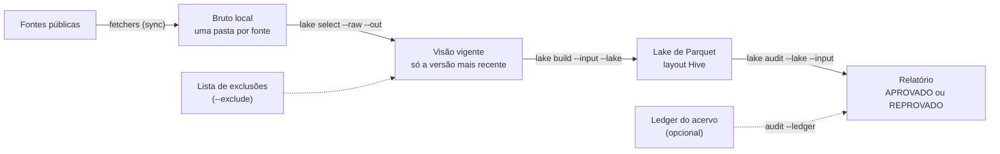

# Montar o lake numa máquina nova

> **Tempo estimado:** menos de 1 minuto para uma fonte pequena; horas a dias para o acervo completo. **Pacotes:** `quantilica-cli` com o extra `lake` e os fetchers com o extra `analysis`.

O lake é a camada de Parquet particionado em Hive onde moram os dados volumosos do ecossistema — microdados do DATASUS, RAIS/CAGED, CNPJ da Receita Federal — prontos para DuckDB, Polars e PyArrow consultarem direto do disco (veja [Padronização de Lake Hive](../normas/lake.md)). Este guia mostra como montar um lake completo numa máquina nova, a partir do bruto, com três comandos: `quantilica lake select`, `build` e `audit`. Nenhum banco de dados é necessário, e o ledger do acervo é opcional.

## Visão geral



1. **Bruto local.** O que os fetchers baixam (`quantilica <fonte> sync`) ou arquivos que você já tem na máquina. Cada download vem acompanhado de um manifesto `.manifest.json` com a URL de origem e o SHA-256. A raiz do bruto tem uma pasta por fonte.
2. **`select`** materializa a **visão vigente**: a mesma árvore do bruto, só com a versão mais recente de cada arquivo (e o manifesto dela). A versão é escolhida pela data `@AAAAMMDD` do nome — veja [Convenções de Armazenamento](../conceitos/storage.md). Os arquivos entram por hardlink; em outro volume, por symlink; sem permissão para symlink, por cópia.
3. **`build`** converte a visão em Parquet: uma tarefa por par (fonte, dataset), cada uma num processo próprio, com retomada de onde parou.
4. **`audit`** lê o rodapé de todos os Parquets e prova que o lake está completo e íntegro: proveniência por SHA-256, cobertura, estrutura e leitores.

### O ledger é opcional

Montar o lake **não** depende do ledger:

- o `select` escolhe a versão vigente pela data no nome do arquivo e pelo manifesto que o acompanha;
- as exclusões — arquivos que não devem ir ao lake, como os corrompidos na própria fonte — vêm de uma lista em arquivo (`--exclude`);
- o `build` só lê a visão;
- o `audit` confere a proveniência contra o SHA-256 dos manifestos ou do próprio arquivo bruto.

O ledger — uma exportação com o caminho e o SHA-256 de cada arquivo bruto — acrescenta três coisas, todas opcionais:

1. **Hardlink de conteúdo repetido.** Se o seu bruto local guarda uma só cópia de cada conteúdo (o caso de um espelho compactado), o ledger identifica arquivos com nomes diferentes e o mesmo SHA-256, que entram na visão como hardlink. Um bruto baixado pelos fetchers já tem todos os arquivos: nada a fazer.
2. **Exclusões geradas, não mantidas à mão.** A lista do `--exclude` pode sair do ledger em vez de um arquivo editado manualmente.
3. **Prova contra o registro, não só contra o disco.** Com `audit --ledger`, a proveniência é conferida também contra o que o acervo registra como vigente — e o audit distingue um lake defeituoso de um bruto local desatualizado (veja [Problemas comuns](#bruto-desatualizado-arquivo-republicado-pela-fonte)).

Quem opera o acervo da Quantilica faz esse caminho com ledger por um comando só, o `quantilica-workers ingest lake-sync`; quem instala os pacotes publicados usa os três comandos deste guia.

Para o `audit --ledger`, o formato é um arquivo UTF-8 com um registro por arquivo bruto — JSON Lines ou CSV com cabeçalho, sempre com `path` (relativo à raiz do bruto) e `sha256`:

```json
{"path": "inmet/dados/2026@20261021.zip", "sha256": "ab12..."}
```

## Requisitos

### Software

- **Python 3.12+** e o [uv](https://github.com/astral-sh/uv);
- a CLI unificada com o extra `lake`, que traz o `quantilica-analytics` (o motor de conversão e de auditoria):

```bash
uv tool install "quantilica-cli[lake]" \
    --index https://index.quantilica.com/simple/ \
    --index-strategy unsafe-best-match
```

O `quantilica-cli` está no PyPI, mas o extra `lake` puxa o `quantilica-analytics`, distribuído no índice da Quantilica — por isso o `--index` e o `--index-strategy unsafe-best-match` (versões antigas dos pacotes do ecossistema permanecem congeladas no PyPI, e a estratégia garante a mais nova entre os índices). Numa virtualenv, o equivalente é `uv pip install "quantilica-cli[lake]"` com as mesmas flags.

- os fetchers das fontes que você quer no lake, **com o extra `analysis`** — o conversor de cada fonte mora nele:

```bash
quantilica install rtn --extra analysis
quantilica install inmet --extra analysis
quantilica install datasus --extra analysis
```

Sem o extra `lake`, os comandos `build` e `audit` avisam o que instalar e saem com código 1 — nada quebra em silêncio.

### Máquina

| Recurso | Ordem de grandeza (acervo completo) |
|---|---|
| Bruto | ~1,1 TB |
| Lake | ~250 GB, mais ~200 GB do CNPJ da Receita Federal |
| Visão (`select`) | ~0 com hardlink; do tamanho do bruto se cair em cópia |
| Temporário (`--scratch`) | na ordem do maior dataset em conversão |

- **RAM: 32 GB ou mais recomendados.** Cada tarefa do `build` roda num processo próprio com o seu limite de memória do DuckDB (`--memory`, ex.: `8GB`); o produto `--workers × --memory` precisa caber na máquina, com folga para o sistema.
- **`--scratch` num SSD.** É lá que os brutos são extraídos e o DuckDB derrama os arquivos temporários — o disco mais lento do sistema vira o gargalo. Antes de começar, o `build` compara o espaço livre no disco do lake e no temporário com uma estimativa e aborta com erro se não couber (`--no-disk-check` desativa a checagem).
- **Visão no mesmo volume do bruto.** O hardlink não atravessa volumes: em volume diferente o `select` recua para symlink (ou cópia), e a visão passa a ocupar espaço de verdade — no pior caso, quase o tamanho do bruto.

## O passo a passo

Os caminhos abaixo são exemplos — troque `/data/...` (Linux/macOS) por `D:\...` ou qualquer outro destino no Windows.

### 1. Baixar o bruto

O lake parte sempre de um bruto local. Baixe as fontes que quer no lake com o `sync` de cada fetcher, cada uma na sua pasta sob a raiz do bruto:

```bash
quantilica rtn sync -o /data/bruto/rtn
quantilica inmet sync -o /data/bruto/inmet
```

Já tem o bruto em disco — um espelho, uma cópia de outra máquina? Pule para o `select`: os comandos não se importam com a origem dos arquivos.

### 2. Visão vigente: `quantilica lake select`

```bash
quantilica lake select --raw /data/bruto --out /data/vigente
```

Saída ilustrativa:

```
✓ Visão em /data/vigente
  arquivos:   1240
  criados:    hardlink=1240 symlink=0 copy=0
  mantidos:   0
  excluídos:  0
  removidos:  0
```

O que o `select` faz:

- mantém, para cada arquivo (chave: diretório + nome-base), **a versão mais recente** pela data `@AAAAMMDD` do nome, com o manifesto dela; versões superadas ficam de fora;
- entra por **hardlink** — sem ocupar espaço; bruto em outro volume, symlink; sem permissão para symlink (Windows sem modo desenvolvedor), cópia;
- é **idempotente**: rodar de novo mantém o que já está certo (`mantidos`), remove o que deixou de ser vigente (`removidos`) e cria só o que falta.

Arquivos que não devem ir ao lake — por exemplo, corrompidos na própria fonte — ficam de fora com `--exclude`, um arquivo texto com um `sha256` ou caminho relativo por linha (linhas vazias e iniciadas por `#` são ignoradas):

```bash
quantilica lake select --raw /data/bruto --out /data/vigente --exclude exclusoes.txt
```

### 3. Construção: `quantilica lake build`

```bash
quantilica lake build --input /data/vigente --lake /data/lake \
    --workers 4 --memory 8GB --scratch /data/scratch
```

- **Uma tarefa por (fonte, dataset)**, descoberta pelo conversor instalado de cada fonte; `--sources rtn,inmet` limita a obra a fontes específicas.
- **Um processo por tarefa**: uma falha não derruba as outras; ao interromper (Ctrl+C), o processo pai encerra também os filhos.
- **Retomável**: o estado fica em `<lake>/.build/<execução>.jsonl`, uma linha por tarefa concluída e uma linha de fechamento quando a execução termina. Se a execução foi interrompida, rodar o mesmo comando a retoma e pula as tarefas que já terminaram sem erro. Depois de uma execução terminada, rodar de novo começa outra que passa por todas as tarefas, e os conversores só reconvertem os arquivos que mudaram (pelo SHA-256). `--retry-errors` refaz só as tarefas que falharam na execução mais recente; `--force` reconverte tudo.
- **Recursos**: `--workers` (processos em paralelo), `--memory` (limite de memória do DuckDB por tarefa), `--threads` (threads do DuckDB por tarefa) e `--scratch` (diretório temporário).
- **Suspensão**: enquanto roda, o `build` impede a suspensão do sistema — `SetThreadExecutionState` no Windows, `caffeinate` no macOS, `systemd-inhibit` no Linux quando disponível. `--allow-sleep` devolve o controle ao sistema.

O resumo sai por fonte — `converted` (arquivos convertidos), `skipped` (já convertidos e coerentes), `errors`, e as tarefas `ok`/`failed`/`already_done`:

```
lake build 20261030T153000Z (48s)
  rtn: converted=24 skipped=0 errors=0 | tasks ok=24 failed=0 already_done=0
  result: ok
```

Códigos de saída: **0** sem erros; **1** se alguma tarefa falhou; **130** se interrompido — depois de uma interrupção, rodar de novo retoma sem refazer o que está pronto. Se a obra parou por falta de espaço (a pré-checagem aborta com erro), libere disco e rode o mesmo comando.

### 4. Auditoria: `quantilica lake audit`

```bash
quantilica lake audit --lake /data/lake --input /data/vigente
```

O audit lê apenas o rodapé de cada Parquet (mais a coluna mais barata do último row group), nunca o arquivo inteiro, e confere, nesta ordem:

1. **Integridade** — cada Parquet abre e o último row group é legível; os membros de arquivos agrupados somam as suas linhas.
2. **Proveniência** — o SHA-256 que cada rodapé registra da origem bate com o bruto da visão (manifesto, ou hash do arquivo) e, com `--ledger`, também com o ledger.
3. **Duplicatas** — o mesmo arquivo bruto, ou duas versões dele, não aparecem duas vezes no lake.
4. **Cobertura** — todo arquivo vigente de fonte com conversor tem Parquet, a menos que o conversor o declare ignorado (gêmeos de formato, arquivos não tabulares) ou que esteja nas exceções.
5. **Estrutura** — profundidade de partição uniforme por dataset, nenhum `.tmp` sobrando, tudo dentro de `<fonte>/<dataset>/`.
6. **Leitores** — `check_dataset` em todos os datasets: DuckDB, Polars e PyArrow concordam. É a etapa mais cara; `--no-readers` pula.

O relatório sai em texto no stdout — `--json` o troca por JSON, `--json-file ARQ` grava o JSON em arquivo mantendo o texto — e o código de saída resume o veredito: **0** aprovado, **1** com achados. Saída ilustrativa:

```
Auditoria do lake /data/lake: APROVADO
  612 Parquets em 25 datasets, 4,100,000,000 linhas, 96 membros
  de arquivos agrupados; 812.4s
  cobertura: 2,300 arquivos vigentes de fontes com conversor, 2,300
  com Parquet, 0 ignorados
```

#### Como ler o relatório

A primeira linha é o veredito: `APROVADO` ou `REPROVADO (N achados)`. Depois vêm os totais, a cobertura e, quando há, a lista de achados por categoria — cada uma diz o que fazer:

| Categoria | O que significa | O que fazer |
|---|---|---|
| `parquet_corrompido` | Parquet que não abre ou com row group ilegível | reconverta o dataset com `--force` (suspeite de queda de energia) |
| `membros_divergentes` | arquivo agrupado cujos membros não somam as suas linhas | reconverta o dataset |
| `sem_proveniencia` | Parquet sem `origin_file` e `origin_sha256` no rodapé | reconverta o dataset |
| `sha256_divergente` | sha256 da origem difere do bruto ou do ledger | confira se o bruto local está desatualizado; senão, reconverta |
| `origem_sem_bruto` | origem que não está no bruto | o bruto local está incompleto — baixe o que falta |
| `origem_superada` | origem é uma versão anterior à vigente, com outro conteúdo | reconverta o dataset a partir da visão nova |
| `origem_fora_do_ledger` | origem que não está no ledger | só com `--ledger`: arquivo fora do registro do acervo |
| `versao_duplicada` | o mesmo arquivo bruto, ou duas versões dele, no lake | reconverta o dataset |
| `sem_parquet` | arquivo bruto vigente de fonte com conversor, sem Parquet | rode o `build` de novo; se for esperado, registre em `--exceptions` |
| `particao_mista` | dataset com Parquets em profundidades de partição diferentes | reconverta o dataset |
| `tmp_sobrando` | restos de escrita (`.tmp`) no lake | confira que nenhum build está rodando e apague |
| `fora_do_layout` | Parquet fora de `<fonte>/<dataset>/` | mova ou apague |
| `leitores` | erro do `check_dataset` (descritor, layout, rodapé ou leitores) | leia a mensagem do achado |

Arquivos sabidamente sem Parquet — os corrompidos na fonte, por exemplo — entram numa lista de exceções para não reprovar o audit: `--exceptions ARQ`, um caminho bruto por linha, aceitando padrões `fnmatch`. Outras flags: `--sources` (auditar só algumas fontes), `--workers` (threads que leem os rodapés), `--rehash` (recalcula o SHA-256 do bruto em vez de confiar no manifesto) e `--no-integrity` (lê só o rodapé, sem o último row group).

## Tempos medidos

Ordens de grandeza medidas num desktop com HDs mecânicos — o disco é o maior gargalo, e SSD para o lake e o `--scratch` muda os tempos de build:

| Operação | Tempo |
|---|---|
| `select` de ~480 mil arquivos (hardlink) | ~6 min |
| `audit --no-readers` sobre o lake completo | ~3 min |
| `audit` com leitores sobre ~16 mil Parquets (~26 bilhões de linhas) | ~22 min |
| Conversão do maior dataset do DATASUS (SIA-PA, ~7,7 bilhões de linhas, compactado por UF) | ~15 h |
| Fonte pequena (24 datasets, ex.: rtn): build completo | < 1 min |

O audit com leitores domina o tempo total porque roda `check_dataset` (três motores) em cada dataset. Para uma checagem rápida do dia a dia, `--no-readers` cobre integridade, proveniência, duplicatas, cobertura e estrutura em minutos.

## Problemas comuns

### A máquina suspende no meio da obra

O `build` impede a suspensão do sistema enquanto roda (veja as flags acima). Políticas agressivas de energia podem suspender assim mesmo — em máquinas que caem sozinhas, desligue a suspensão e a hibernação antes de uma obra longa (no Windows, `powercfg /h off` desliga a hibernação). `--allow-sleep` devolve o controle ao sistema quando você prefere assim.

### Queda de energia

Cada Parquet do lake é gravado com `fsync` e publicado por troca atômica: escreve em `.tmp` e renomeia para o nome final (detalhes em [Padronização de Lake Hive](../normas/lake.md)) — não fica arquivo pela metade com nome final. Depois de uma queda de energia, rode o `audit`: um Parquet truncado aparece como `parquet_corrompido`, e o dataset afetado se reconverte com `--force` (a tarefa consta como pronta no estado do build, então a retomada comum a pularia):

```bash
quantilica lake build --input /data/vigente --lake /data/lake --sources <fonte> --force
```

### Processos órfãos

Interromper com **Ctrl+C** é seguro: o processo pai encerra a árvore inteira de processos filhos. Matar o pai à mão, sem avisar os filhos, pode deixá-los órfãos — se precisar matar à mão, mate a árvore (no Windows, `taskkill /PID <pid> /T`) e confira depois que não sobrou nenhum processo de conversão rodando.

### Antivírus varrendo o temporário

O `--scratch` recebe extração de arquivos compactados e os temporários do DuckDB, em rajadas de escrita e exclusão. Um antivírus varrendo esse diretório em tempo real multiplica o tempo da obra e pode até causar falhas de leitura — exclua o diretório do `--scratch` da varredura em tempo real.

### Hardlink entre volumes

O hardlink não atravessa volumes nem sistemas de arquivos de rede. Bruto e visão em volumes diferentes fazem o `select` recuar para symlink (ou cópia), e a visão passa a ocupar espaço — no pior caso, quase o tamanho do bruto. A recomendação: bruto e visão na mesma unidade; o lake pode ficar em outra.

### Windows: processos longos por SSH

No Windows, o servidor SSH encerra os processos da sessão quando ela desconecta — um `build` de 15 h iniciado por SSH morre junto com a conexão, e `Start-Process` não escapa disso (o processo criado continua preso à sessão). Crie o processo **fora da sessão** com `Win32_Process.Create`:

```powershell
Invoke-CimMethod -ClassName Win32_Process -MethodName Create -Arguments @{
    CommandLine = 'cmd /c quantilica lake build -i D:\vigente --lake D:\lake --scratch D:\scratch > D:\lake\build.log 2>&1'
}
```

A saída vai para `D:\lake\build.log`; acompanhe de outra sessão com `Get-Content D:\lake\build.log -Wait`.

### Dataset grande em outro disco

Um dataset que não cabe no disco do lake pode morar em outra unidade e entrar no lake por **junção de diretório** (Windows, `mklink /J`) ou **symlink de diretório** (Linux, `ln -s`). O audit entende links: não conta o mesmo Parquet duas vezes — um link que aponta para dentro do lake é pulado (o destino é alcançado no lugar), e um que aponta para fora é seguido uma vez por destino real — e lista cada link no relatório (`link <caminho> -> <destino>`).

### Bruto desatualizado (arquivo republicado pela fonte)

Algumas fontes republicam o arquivo **com o mesmo nome** — sem data no nome, ou com data que não muda — e o bruto local (um espelho, uma cópia antiga) fica com os bytes anteriores. Sem ledger, o audit reporta `sha256_divergente`, e não dá para distinguir lake defeituoso de bruto velho. Com `audit --ledger`, o audit cruza os três lados: quando o rodapé do lake bate com o ledger e não com o arquivo local, o relatório emite um aviso de **bruto local desatualizado** — o lake está certo; é o bruto que precisa ser baixado de novo.

## Veja também

- [Padronização de Lake Hive](../normas/lake.md) — o contrato completo: layout, metadados de rodapé, descritor `_dataset.json` e atomicidade
- [quantilica-analytics](../fundacoes/quantilica-analytics.md) — `LakeWriter`, `scan_dataset` e `check_dataset`
- [quantilica-cli](../fundacoes/quantilica-cli.md) — instalação de fontes e comandos por fetcher
- [Convenções de Armazenamento](../conceitos/storage.md) — a nomenclatura `{base}@{timestamp}.{ext}` e a semântica de versão
- [Proveniência & Manifestos](../conceitos/proveniencia.md) — os manifestos SHA-256 que o audit usa
