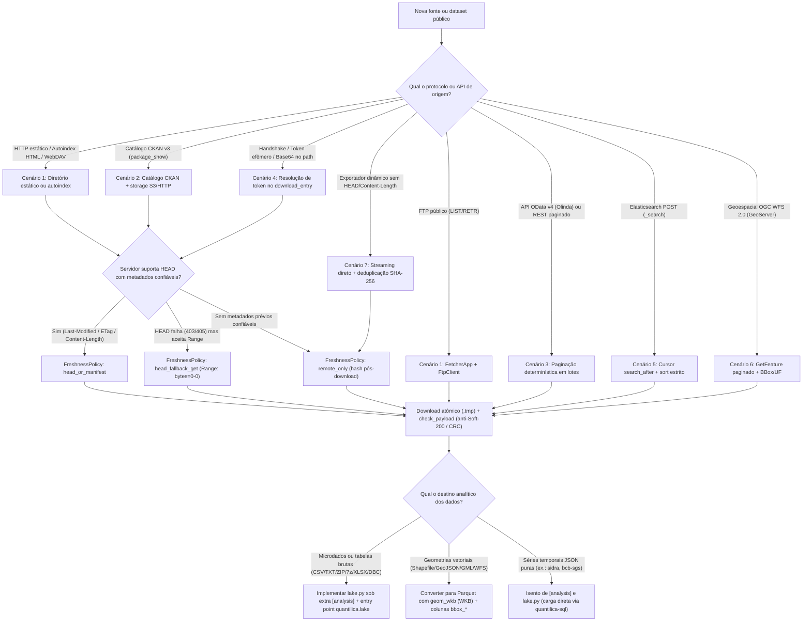
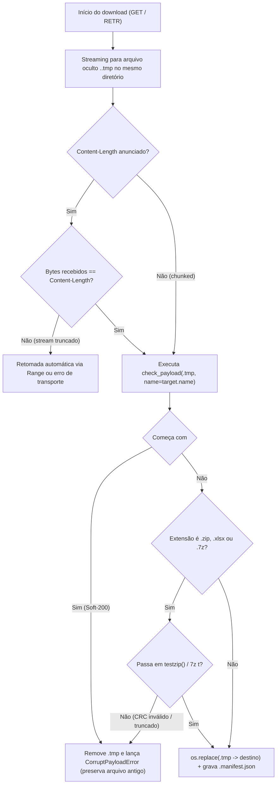

# Cenários, arquétipos de fonte e casos especiais

> Parte da norma [Padronização de CLI para Fetchers](../cli-fetchers.md). Os números de seção (§) são os da norma completa.

Esta página consolida os padrões arquiteturais e operacionais para implementar coletores diante da diversidade de portais, protocolos e formatos encontrados nos órgãos públicos brasileiros. Ela orienta a escolha do arquétipo de transporte, da política de verificação de frescor (*freshness*), do particionamento no armazenamento bruto e do tratamento de casos extremos na conversão para o [Lake Hive](../lake.md).

---

## 14. Visão geral e árvore de decisão

Antes de escrever um novo coletor ou adicionar um conjunto de dados a um coletor existente, classifique a fonte pública segundo quatro eixos:

1. **Mecanismo de descoberta e transporte**: como os artefatos são listados e transferidos (HTTP estático, CKAN, FTP, OData/REST, Elasticsearch ou OGC WFS).
2. **Confiabilidade dos metadados HTTP**: se o servidor responde a requisições `HEAD` com `Last-Modified`, `ETag` ou `Content-Length` fidedignos.
3. **Granularidade de armazenamento bruto**: como nomear e organizar os arquivos baixados sob `/data/<fonte>/<dataset_id>/` (ver [Convenções de Armazenamento](../../conceitos/storage.md)).
4. **Natureza analítica para o Lake**: se os dados constituem microdados/tabelas volumosas que exigem conversão para Parquet Hive (`lake.py` sob o extra `[analysis]`) ou séries agregadas leves em JSON consumidas diretamente pela camada relacional.



---

## 15. Arquétipos de fonte e transporte (7 cenários canônicos)

### 15.1 Cenário 1 — Diretórios estáticos, Autoindex HTML, FTP e WebDAV

**Exemplos no ecossistema:** `cvm-fetcher`, `rfb-cnpj-fetcher`, `pdet-fetcher`, `datasus-fetcher`, `comex-fetcher`, `tse-fetcher`.

Neste arquétipo, o órgão publica arquivos brutos (`.zip`, `.7z`, `.csv`, `.dbc`) em árvores de diretórios navegáveis via HTTP (listagens Apache/Nginx autoindex ou WebDAV como OwnCloud/Nextcloud) ou servidores FTP públicos.

- **Descoberta (`list_datasets`)**: o coletor raspa a página de diretório HTML (ou executa `MLSD`/`LIST` via `FtpClient` ou `PROPFIND` em WebDAV) para descobrir dinamicamente as partições disponíveis (anos, meses, UFs) sem fixar datas no código.
- **Orquestração**: utiliza `FetcherApp` com `default_path_builder` (ou `DataRepository`).
- **Servidores FTP (`pdet-fetcher`, `datasus-fetcher`)**: utilizam `FtpClient` de `quantilica.core.ftp`, que aplica escrita atômica com manifesto (`download_with_manifest`) e verificação de integridade do arquivo baixado antes de substituir o destino final.

```python
from quantilica.cli.sdk import FetcherApp, default_client

def list_cvm_entries(group_id: str) -> list[dict[str, object]]:
    # Descobre arquivos .zip ou .csv publicados no autoindex da fonte
    with default_client() as client:
        html = client.get_text(f"https://dados.cvm.gov.br/dados/CIA_ABERTA/DOC/{group_id.upper()}/DADOS/")
    return parse_autoindex_links(html, group_id=group_id)
```

### 15.2 Cenário 2 — Portais CKAN v3 (`package_show`) e híbrido CKAN + S3

**Exemplos no ecossistema:** `tesouro-direto-fetcher`, `anp-fetcher`, `anac-fetcher`, além de portais baseados em CKAN (como `dados.gov.br`, ONS, ANEEL, ANS e ANTT).

Muitos órgãos mantêm um catálogo de metadados em CKAN v3 cuja API JSON (`GET /api/3/action/package_show?id=<dataset_slug>`) lista os recursos (`resources`), enquanto os arquivos binários residem em buckets S3, storages de objetos ou CDNs externos.

- **Consulte a API CKAN, não raspe o HTML do portal**: a resposta de `package_show` entrega para cada item de `result.resources` a URL de download (`url`), o formato (`format`), a data de modificação declarada (`last_modified` ou `metadata_modified`) e o identificador estável (`id`).
- **Preservação de metadados em redirecionamentos S3**: quando o storage final não devolve `Last-Modified` no `HEAD` ou usa URLs assinadas temporárias, o coletor deve propagar a data `last_modified` obtida no JSON do CKAN na entrada do catálogo (`entry["last_modified"]`), garantindo o carimbo `@YYYYMMDD` correto no nome do arquivo local.
- **Filtragem determinística de recursos**: filtre recursos de documentação (`.pdf`, `.doc`, dicionários soltos) ou direcione-os para `_documentacao/`, mantendo apenas os artefatos de dados nas entradas de sincronização do grupo.

```python
def fetch_ckan_resources(package_id: str) -> list[dict[str, object]]:
    url = f"https://www.tesourotransparente.gov.br/ckan/api/3/action/package_show?id={package_id}"
    with default_client() as client:
        payload = client.get_json(url)
    resources = payload.get("result", {}).get("resources", [])
    entries: list[dict[str, object]] = []
    for res in resources:
        if str(res.get("format", "")).lower() not in {"csv", "zip", "parquet"}:
            continue
        entries.append(
            {
                "group": package_id,
                "id": slugify(res["name"]),
                "url": res["url"],
                "ext": str(res["format"]).lower(),
            }
        )
    return entries
```

### 15.3 Cenário 3 — APIs OData v4 (Olinda) e REST paginado

**Exemplos no ecossistema:** `bcb-sgs-fetcher`, endpoints Olinda OData v4 (Expectativas Focus, Pix, IFData, PTAX), PNCP e SICONFI (STN).

Fontes transacionais ou de séries granulares frequentemente expõem endpoints OData v4 ou APIs REST paginadas por deslocamento (`$top` e `$skip` ou `pagina` e `tamanhoPagina`).

- **Ordenação determinística obrigatória**: em toda consulta OData paginada, inclua explicitamente `$orderby` por chave primária ou carimbo temporal (ex.: `$orderby=Data asc,Id asc`). Sem `$orderby`, o banco de dados de origem pode devolver registros duplicados ou omitir linhas entre páginas adjacentes.
- **Fatiamento por partição lógica**: em vez de baixar milhões de linhas num único arquivo monolítico sem retomada, particione a coleta por ano ou competência mensal (`$filter=AnoMes eq 202401`) e persista um artefato bruto por partição com seu respectivo manifesto `.manifest.json`.
- **Parada segura de paginação**: encerre o laço quando a página atual trouxer menos registros que `$top` (ou quando `@odata.nextLink` estiver ausente).

```python
def fetch_odata_partition(
    endpoint: str,
    *,
    page_size: int = 10_000,
    order_by: str = "Data asc",
) -> list[dict[str, object]]:
    rows: list[dict[str, object]] = []
    skip = 0
    with default_client() as client:
        while True:
            params = {
                "$format": "json",
                "$top": str(page_size),
                "$skip": str(skip),
                "$orderby": order_by,
            }
            payload = client.get_json(endpoint, params=params)
            batch = payload.get("value", [])
            rows.extend(batch)
            if len(batch) < page_size:
                break
            skip += page_size
    return rows
```

### 15.4 Cenário 4 — Handshake em 2 etapas, tokens efêmeros e parâmetros Base64 no path

**Exemplos no ecossistema:** `b3-fetcher` e sistemas de consulta financeira/regulatória que exigem sessão prévia ou codificação de parâmetros na rota.

Alguns sistemas não expõem links diretos fixos: o download requer (a) codificar um dicionário JSON de filtros em Base64 na própria rota HTTP ou (b) realizar uma chamada preparatória para obter um token de sessão/download de curta duração (TTL de poucos minutos).

- **Resolução tardia (*lazy*) no `download_entry`**: nunca gere tokens efêmeros durante a fase de listagem (`list_datasets` ou `check`), pois em coletas longas o token expirará antes que o worker alcance os últimos itens da fila. A entrada do catálogo deve guardar os parâmetros lógicos (ex.: ano, código do índice, página), e o `download_entry` realiza o handshake imediatamente antes da transferência do arquivo.
- **URL canônica no manifesto**: registre no `DownloadManifest` a URL canônica ou lógica do recurso (sem tokens secretos voláteis na query string), preservando a reprodutibilidade e a comparação de frescor.

```python
import base64
import json

def build_b64_endpoint(base_url: str, params: dict[str, object]) -> str:
    raw = json.dumps(params, separators=(",", ":"), ensure_ascii=False).encode("utf-8")
    token = base64.urlsafe_b64encode(raw).decode("ascii")
    return f"{base_url.rstrip('/')}/{token}"
```

### 15.5 Cenário 5 — Buscadores Elasticsearch POST (`search_after`) com chave pública

**Exemplos de aplicação:** API Pública do DataJud (CNJ) e portais de jurisprudência ou diários oficiais indexados em Elasticsearch/OpenSearch.

Índices Elasticsearch bloqueiam paginação profunda com `from + size` acima de 10.000 documentos (`index.max_result_window`). A extração integral exige paginação por cursor via **`search_after`**.

- **Ordenação estrita e desempate único**: o corpo do `POST /<indice>/_search` deve especificar um array `sort` determinístico contendo um campo temporal/sequencial e um campo de desempate único (ex.: `[{"@timestamp": "asc"}, {"_id": "asc"}]`).
- **Avanço do cursor**: a cada resposta, extraia o atributo `sort` do último elemento de `hits.hits` e passe-o no campo `search_after` da requisição seguinte até que `hits.hits` retorne vazio.
- **Autenticação por chave pública da fonte**: quando o portal governamental publica uma `APIKey` oficial de acesso público na própria documentação da API, o coletor define essa chave como constante padrão documentada, permitindo sobreposição via variável de ambiente (ex.: `QUANTILICA_<FONTE>_API_KEY`) caso o órgão rotacione a chave.
- **Armazenamento bruto em NDJSON (`.jsonl`)**: grave os documentos paginados em lotes particionados por unidade/tribunal e período no formato `.jsonl` (ou `.jsonl.zst`), facilitando a conversão colunar posterior no `lake.py`.

```python
def iter_search_after(
    client,
    url: str,
    query: dict[str, object],
    *,
    page_size: int = 1_000,
):
    search_after: list[object] | None = None
    while True:
        body: dict[str, object] = {
            "size": page_size,
            "query": query,
            "sort": [{"dataHoraUltimaAtualizacao": "asc"}, {"id": "asc"}],
        }
        if search_after is not None:
            body["search_after"] = search_after
        resp = client.post_json(url, json=body)
        hits = resp.get("hits", {}).get("hits", [])
        if not hits:
            break
        yield hits
        search_after = hits[-1]["sort"]
```

### 15.6 Cenário 6 — Serviços geoespaciais OGC WFS 2.0 / GeoServer

**Exemplos de aplicação:** bases fundiárias, ambientais e hidrográficas servidas por GeoServer governamental (INCRA, SICAR/CAR, ANA, IBAMA, ICMBio).

Servidores GeoServer frequentemente truncam downloads únicos ou sofrem timeout quando solicitados a exportar milhões de polígonos de uma só vez.

- **Protocolo OGC WFS 2.0.0 paginado**: utilize `service=WFS`, `version=2.0.0`, `request=GetFeature`, `typeNames=<namespace>:<camada>`, `outputFormat=application/json` (ou `SHAPE-ZIP`), combinados com `count=<tamanho_pagina>`, `startIndex=<offset>` e **`sortBy=<chave_primaria>+A`**. Sem `sortBy`, o GeoServer não garante ordem estável entre páginas.
- **Fatiamento geográfico por UF ou `BBOX`**: para camadas nacionais densas, divida o catálogo de entradas por Unidade da Federação (`CQL_FILTER=uf='SP'`) ou por quadrículas espaciais (`BBOX=minx,miny,maxx,maxy,EPSG:4674`), permitindo retomada independente por partição.
- **Conversão para o Lake**: na camada `lake.py`, converta as geometrias para **WKB (`geom_wkb`)** acompanhadas das quatro colunas de envelope (`bbox_minx`, `bbox_miny`, `bbox_maxx`, `bbox_maxy`), conforme detalhado na [§17.5](#175-geometrias-vetoriais-no-lake-geom_wkb-e-bounding-box).

### 15.7 Cenário 7 — Endpoints dinâmicos sem metadados HTTP confiáveis

**Exemplos no ecossistema:** `anp-fetcher`, `inep-fetcher` e sistemas legados que geram arquivos CSV/ZIP dinamicamente ou operam atrás de proxies que suprimem cabeçalhos.

Nesses servidores, requisições `HEAD` retornam `405 Method Not Allowed`, `403 Forbidden` ou `200 OK` com `Content-Length: 0` e sem `Last-Modified`/`ETag`.

- **Download em streaming com validação de payload**: o coletor faz o download via `GET` em streaming para arquivo temporário, valida se o conteúdo não é uma página HTML de erro (`check_payload`) e calcula o hash SHA-256 em trânsito.
- **Deduplicação pós-download por SHA-256**: quando o arquivo local já existe e o servidor não informou `Last-Modified` nem `ETag`, compare o `sha256` recém-baixado com o registrado no `.manifest.json` local, preservando a idempotência do histórico e evitando reprocessamentos desnecessários no Lake.

---

## 16. Servidores governamentais imperfeitos: freshness e validação de payload

### 16.1 Políticas de verificação de frescor (`FreshnessPolicy`)

Nem todo servidor público suporta o fluxo HTTP ideal (`HEAD` retornando `ETag` e `Last-Modified`). A tabela a seguir define a política canônica para cada comportamento de servidor:

| Política | Comportamento do servidor | Mecanismo no `check` e no `sync` | Quando aplicar |
|---|---|---|---|
| `head_or_manifest` *(padrão)* | Responde `HEAD` 200 com `Last-Modified`, `ETag` ou `Content-Length` real | Executa `HEAD`; compara `ETag`/`Last-Modified`/`Content-Length` com o `.manifest.json` local | Servidores HTTP estáticos padrão, CDNs e buckets S3 públicos |
| `head_fallback_get` | Rejeita `HEAD` (`403`, `405`, `501`) ou omite tamanho/data no `HEAD`, mas suporta `Range` no `GET` | Tenta `HEAD`; se falhar ou vier vazio, emite `GET` com cabeçalho `Range: bytes=0-0` e extrai o tamanho total de `Content-Range: bytes 0-0/<total>`, além de `Last-Modified`/`ETag` | Gateways WAF e servidores de aplicação que bloqueiam `HEAD` mas servem arquivos estáticos |
| `remote_only` *(deduplicação SHA-256)* | Gerador dinâmico sem `HEAD`, sem `Range` e sem `Last-Modified` confiável | No `check`, sinaliza ausência de metadados remotos; no `sync`, baixa em `.tmp`, valida `check_payload` e compara o hash SHA-256 com o `.manifest.json` existente | Exportadores dinâmicos (`POST`/scripts server-side) e portais sem suporte a `HEAD`/`Range` |

### 16.2 Prevenção de Soft-200 (páginas HTML de erro com HTTP 200) e arquivos truncados

Um problema recorrente em portais públicos é o **Soft-200**: o servidor sofre uma falha interna ou bloqueio de firewall e devolve status `HTTP 200 OK`, mas o corpo da resposta é uma página HTML (`<!DOCTYPE html><html>...Sistema temporariamente indisponível...`) no lugar do arquivo `.csv`, `.zip` ou `.7z` esperado. Se gravado diretamente no destino, esse arquivo corrompe o armazenamento local e inutiliza a versão íntegra anterior.

Para impedir essa classe de corrupção, toda escrita de arquivo bruto passa obrigatoriamente por validação no arquivo temporário **antes** do `os.replace` atômico, utilizando `check_payload(temp_path, name=target.name)` de `quantilica.core.files`:

1. **Detecção de HTML disfarçado (Soft-200)**: para extensões de dados (`.csv`, `.txt`, `.zip`, `.7z`, `.xls`, `.xlsx`, `.json`, `.dbc`, `.dbf`), os primeiros 512 bytes (desconsiderando BOM UTF-8 e espaços iniciais) são inspecionados. Se começarem com `<!doctype html` ou `<html`, `check_payload` lança `CorruptPayloadError`.
2. **Integridade estrutural de arquivos `.zip` e `.xlsx`**: o arquivo é aberto com `zipfile.ZipFile` e submetido a `archive.testzip()`, verificando o diretório central e o CRC-32 de todos os membros internos (detectando downloads truncados no meio do stream).
3. **Integridade estrutural de arquivos `.7z`**: quando o binário `7z`/`7zz`/`7za` está presente no sistema, executa `7z t -bd <arquivo>` para validar cabeçalhos e blocos comprimidos.



---

## 17. Casos especiais de layout, encoding e schema no Lake

### 17.1 ZIPs multi-membro e XLSX multi-aba (`composite_file_key`)

Em diversas fontes (como `cvm-fetcher`, `anac-fetcher`, `tse-fetcher` e planilhas históricas multi-aba como `rtn-fetcher`), um único arquivo bruto baixado (ex.: `itr_cia_aberta_2024@20260501.zip`) contém dezenas de tabelas ou membros distintos que mapeiam para o mesmo dataset ou partição no Lake Hive.

Se todos os membros internos usassem apenas `file_key(raw_file)` (`itr_cia_aberta_2024`), a conversão do segundo membro sobrescreveria e apagaria o Parquet gerado pelo primeiro membro.

**Regra normativa:** sempre que um arquivo bruto contiver múltiplos membros ou abas convertidos para o mesmo diretório de partição, componha o identificador do arquivo Parquet com `composite_file_key(raw_file, member)`:

$$\text{composite\_file\_key}(\text{raw\_file}, \text{member}) \longrightarrow \texttt{\{file\_key\}\_\_\{member\_slug\}}$$

- O separador canônico entre o `file_key` do pacote bruto e o identificador sanitizado do membro interno (ou aba da planilha) é o **duplo sublinhado (`__`)**.
- Exemplo: o membro `itr_cia_aberta_BPA_con_2024.csv` dentro de `itr_cia_aberta_2024@20260501.zip` produz `itr_cia_aberta_2024__itr_cia_aberta_bpa_con_2024.parquet` (ou `-001.parquet`, `-002.parquet` se fatiado por tamanho).
- Alternativamente, quando os membros possuem a mesma estrutura e devem ser consolidados em um único Parquet por partição, utilize a escrita agrupada do `LakeWriter`, que registra cada membro em `quantilica.members` no rodapé do Parquet e identifica a linha pela coluna `_origem`.

```python
from pathlib import Path
from quantilica.core.lake import file_key
from quantilica.core.storage import slugify

def composite_file_key(raw_file: str | Path, member: str) -> str:
    """Combina o file_key do artefato bruto com o identificador do membro/aba."""
    base_key = file_key(raw_file)
    member_stem = file_key(member)
    member_slug = slugify(member_stem).replace("-", "_")
    return f"{base_key}__{member_slug}"
```

### 17.2 Encodings mistos no mesmo arquivo compactado

Pacotes governamentais históricos frequentemente misturam arquivos em `UTF-8` (com ou sem BOM) e arquivos em `CP1252` / `ISO-8859-1` dentro do **mesmo** arquivo `.zip` ou `.7z` (comum em remessas do `tse-fetcher`, `cvm-fetcher` e `inep-fetcher`).

- **Inspeção por membro interno**: nunca assuma que todos os CSVs de um `.zip` compartilham a mesma codificação de caracteres. A detecção de encoding deve ocorrer por membro extraído.
- **Promoção automática de `ISO-8859-1` para `CP1252`**: arquivos declarados por órgãos públicos como `Latin-1` / `ISO-8859-1` frequentemente contêm caracteres da faixa `0x80`–`0x9F` do Windows-1252 (como travessão `–`, aspas curvas `“`/`”` e símbolo `€`). O `LakeWriter` inspeciona automaticamente a presença de bytes C1 (`[\x80-\x9f]`) em arquivos declarados como `latin-1` e promove a leitura para `CP1252`, evitando caracteres de controle inválidos no Parquet.

### 17.3 Evolução de layout (*Schema Drift* e múltiplas eras históricas)

Séries históricas longas de microdados (como RAIS desde 1985, CAGED → Novo CAGED, ENEM desde 1998, Censo Escolar e notas fiscais/comércio exterior) sofrem mudanças estruturais ao longo das décadas: colunas são renomeadas, códigos mudam de tamanho e novos atributos passam a existir apenas a partir de determinado ano.

Para que `scan_dataset()` (Polars), DuckDB e PyArrow consigam ler toda a série histórica com um único contrato (`DataContract`):

1. **Contrato como superconjunto canônico**: o `DataContract` do dataset declara a união das colunas relevantes em seus nomes canônicos modernos (`snake_case` ASCII).
2. **Mapa de aliases históricos por safra**: o conversor em `lake.py` aplica um dicionário de renomeação (`RENAME_MAP`) que traduz nomes legados de colunas (ex.: `VL_REMUN_MEDIA_NOM` → `remuneracao_media_nominal`) antes da validação do contrato.
3. **Injeção de colunas ausentes como `NULL` tipado**: colunas do contrato que não existiam em safras antigas são adicionadas com `pl.lit(None, dtype=col_spec.dtype).alias(col_spec.name)` (ou `CAST(NULL AS <TIPO>)` no DuckDB), garantindo que todos os arquivos Parquet do dataset possuam exatamente o mesmo schema físico e a mesma ordem de colunas.

```python
import polars as pl
from quantilica.analytics.schema import DataContract

def align_historical_era(
    lf: pl.LazyFrame,
    contract: DataContract,
    alias_map: dict[str, str],
) -> pl.LazyFrame:
    schema_names = set(lf.collect_schema().names())
    # 1. Renomeia aliases históricos presentes na safra atual
    active_renames = {old: new for old, new in alias_map.items() if old in schema_names}
    if active_renames:
        lf = lf.rename(active_renames)
        schema_names = set(lf.collect_schema().names())

    # 2. Injeta colunas ausentes na safra histórica com NULL tipado e seleciona na ordem do contrato
    exprs: list[pl.Expr] = []
    for col_name, col_dtype in contract.dtypes.items():
        if col_name in schema_names:
            exprs.append(pl.col(col_name).cast(col_dtype, strict=False))
        else:
            exprs.append(pl.lit(None, dtype=col_dtype).alias(col_name))
    return lf.select(exprs)
```

### 17.4 Códigos alfanuméricos e preservação de zeros à esquerda (`pl.String`)

> **Regra inquebrável de modelagem:** Códigos cadastrais, fiscais, postais, geográficos e classificadores estatísticos **JAMAIS** devem ser tipados como inteiros (`Int32`/`Int64`). Eles devem ser declarados obrigatoriamente como `pl.String` (`VARCHAR` no DuckDB / `pa.string()` no PyArrow).

Converter identificadores para inteiro destrói zeros à esquerda significativos (transformando o CNPJ `00000000000191` em `191` ou o CEP `01001000` em `1001000`) e causa falha catastrófica diante de códigos alfanuméricos. Em especial, o **CNPJ passa a admitir caracteres alfanuméricos (`[0-9A-Z]{12}[0-9]{2}`)** a partir de julho de 2026 conforme norma da Receita Federal do Brasil.

| Categoria de código | Exemplos de campos | Tipo obrigatório no `DataContract` | Formato / observação |
|---|---|---|---|
| Identificadores empresariais e pessoais | `cnpj`, `cnpj_basico`, `cnpj_ordem`, `cnpj_dv`, `cpf` | `pl.String` | Preserva zeros à esquerda e suporta CNPJ alfanumérico (`[0-9A-Z]`) |
| Códigos territoriais e postais | `codigo_municipio_ibge`, `codigo_uf_ibge`, `cep` | `pl.String` | Evita perda do zero inicial em CEPs de SP (`01...`–`09...`) |
| Classificações econômicas e laborais | `cnae`, `cnae_subclasse`, `cbo`, `ncm`, `sh4`, `cfop` | `pl.String` | Preserva prefixos `0` (ex.: capítulos agropecuários `01`–`09`) |
| Identificadores de infraestrutura e processos | `numero_processo_cnj`, `codigo_inep_escola`, `codigo_cnes`, `codigo_icao` | `pl.String` | Numeração composta com dígitos verificadores e zeros iniciais |

Ao ingerir CSVs com DuckDB ou Polars no `lake.py`, leia todas as colunas brutas inicialmente como texto (`all_varchar = true` no `read_csv` do DuckDB ou `infer_schema_length = 0` no Polars) antes de aplicar os casts explícitos do `DataContract`. Isso impede que o leitor infira `BIGINT` nas primeiras milhares de linhas numéricas e falhe ou trunque zeros nas linhas seguintes.

### 17.5 Geometrias vetoriais no Lake (`geom_wkb` e Bounding Box)

Quando um coletor processa dados geoespaciais vetoriais (polígonos de imóveis rurais, limites municipais, bacias hidrográficas, linhas de transmissão, malhas viárias), o armazenamento no Lake Hive deve ser legível por qualquer motor Parquet padrão sem depender obrigatoriamente de extensões geoespaciais carregadas em tempo de leitura básica:

1. **Coluna `geom_wkb` em WKB (`pa.binary()` / `pl.Binary`)**: a geometria vetorial é serializada no padrão ISO/OGC **Well-Known Binary (WKB)** na coluna nomeada `geom_wkb`.
2. **Sistema de referência de coordenadas (CRS)**: padronizado em **SIRGAS 2000 (`EPSG:4674`)** ou **WGS 84 (`EPSG:4326`)**, em coordenadas geográficas `(longitude, latitude)` na ordem de eixos padrão `(X, Y)`.
3. **Colunas numéricas de envelope espacial (*Bounding Box*)**: todo registro geoespacial deve incluir quatro colunas `Float64` (`DOUBLE`):
   - `bbox_minx` (longitude oeste mínima)
   - `bbox_miny` (latitude sul mínima)
   - `bbox_maxx` (longitude leste máxima)
   - `bbox_maxy` (latitude norte máxima)

Essas quatro colunas permitem que motores colunares (DuckDB, Polars, PyArrow) filtrem espacialmente milhões de registros via *predicate pushdown* e estatísticas de `row group` (`min`/`max` nativos do Parquet) em milissegundos, desserializando o binário `geom_wkb` apenas para os polígonos candidatos que intersectam a área de interesse.

---

## 18. Fronteira de acesso e dados pessoais em fontes públicas

### 18.1 Cabeçalhos de navegador e limites de contorno (`default_client`)

Muitos portais governamentais operam atrás de WAFs que bloqueiam clientes com `User-Agent` genérico de biblioteca (como `python-httpx` ou `urllib`) ou rejeitam requisições com `Accept-Encoding: br, zstd` retornando `HTTP 406 Not Acceptable` ou `HTTP 403 Forbidden`.

- **Uso obrigatório de `default_client()`**: o cliente padrão do SDK (`quantilica.cli.sdk.default_client()`) instancia o `HttpClient` com `emulate_browser=True` (`BROWSER_HEADERS` realistas e `Accept-Encoding: gzip, deflate`), pool de conexões persistentes, retentativas com *backoff* exponencial e retomada automática de streams interrompidos via `Range`.
- **Cadeias TLS governamentais (ICP-Brasil / SERPRO)**: quando um servidor público apresenta cadeia intermediária incompleta, o operador pode fornecer um bundle customizado via `QUANTILICA_CA_BUNDLE` ou contornar pontualmente via `QUANTILICA_SSL_VERIFY=false` no ambiente — um coletor nunca desativa a verificação TLS (`verify=False`) como padrão codificado no código-fonte.
- **Limites éticos e técnicos de contorno**: os coletores do ecossistema acessam exclusivamente dados públicos oficiais por meio de requisições HTTP/FTP padronizadas. **É expressamente vedado** implementar em qualquer pacote coletor:
  - Resolução automatizada ou contorno de CAPTCHA (hCaptcha, reCAPTCHA, Turnstile, Gov.br);
  - Automação com credenciais pessoais privadas (CPF/senha individual);
  - Evasão de bloqueio por rotação de IPs/proxies ou falsificação de cabeçalhos de encaminhamento (`X-Forwarded-For`).

### 18.2 Espelhamento fiel da fonte pública (sem filtragem no coletor)

Órgãos públicos frequentemente publicam bases abertas que contêm nomes ou identificadores parciais de pessoas físicas por determinação legal de transparência ativa — como o Quadro de Sócios e Administradores (QSA) na base de CNPJ da Receita Federal, registros de candidaturas e doações eleitorais no TSE, administradores de fundos na CVM ou titulares de processos administrativos e judiciais públicos.

- **O coletor espelha a fonte pública sem filtrar**: a responsabilidade arquitetural do pacote `*-fetcher` (no `sync`) e do seu conversor `lake.py` (no `convert`) é produzir uma representação íntegra, auditável e fiel ao arquivo oficial publicado pelo órgão.
- **Proibição de mascaramento ou descarte silencioso na ingestão**: o coletor e o conversor do Lake **não** devem mascarar, aplicar hash, pseudonimizar ou descartar colunas existentes no arquivo bruto original. Qualquer política de seleção de campos, anonimização, agregação estatística ou controle de exibição para usuários finais pertence exclusivamente às camadas posteriores de marts analíticos e aplicações consumidoras.
