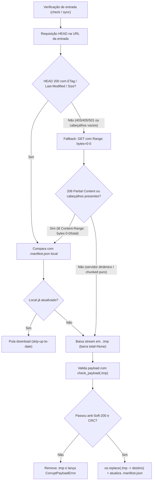

# Erros, fluxos e anti-padrões

> Parte da norma [Padronização de CLI para Fetchers](../cli-fetchers.md). Os números de seção (§) são os da norma completa.

## 7. Tratamento de erros e códigos de saída

### 7.1 Códigos de saída padronizados

| Código | Significado |
|---|---|
| `0` | Sucesso completo |
| `1` | Erro de execução (argumento inválido pós-parse, arquivo não encontrado, etc.) |
| `2` | Uso incorreto (argparse usa 2 automaticamente para erros de sintaxe) |

### 7.2 `typer.Exit` no `plugin.py`

```python
# Erro fatal com mensagem
console.print(f"[red]Erro:[/red] arquivo não encontrado: {ids_file}")
raise typer.Exit(code=1)

# Interrupção pelo usuário (Ctrl+C)
try:
    asyncio.run(_run())
except KeyboardInterrupt:
    console.print("[yellow]Download cancelado.[/yellow]")
    raise typer.Exit(code=130)
```

### 7.3 Confirmação antes de operações destrutivas ou muito longas

```python
@app.command("all")
def all_datasets(
    yes: Annotated[
        bool, typer.Option("-y", "--yes", help="Confirmar sem prompt")
    ] = False,
) -> None:
    """Baixar TUDO (todos os anos, todas as tabelas)."""
    if not yes:
        typer.confirm(
            "Isso pode demorar muito e usar vários GBs. Continuar?",
            abort=True,
        )
    download_all(...)
```

`abort=True` faz `typer.confirm` encerrar com `typer.Exit(code=1)` se o usuário responder "n".

### 7.4 Erros não-fatais em loops bulk

Erros que afetam um item dentro de um loop não devem encerrar toda a operação. Use logging e continue:

```python
for item in items:
    try:
        processar(item)
        successful += 1
    except Exception as exc:
        logger.error("Falha em %s: %s", item, exc)
        failed += 1
```

Ao final do loop, exiba o resumo:

```python
if failed:
    console.print(f"[yellow]⚠[/yellow]  {successful} OK · [red]{failed} falha(s)[/red]")
else:
    console.print(f"[green]✓[/green]  [bold]{successful}[/bold] itens processados.")
```

---

## 8. Pipelines de vários passos

Fetchers com fluxos de trabalho longos (ex: arvore-grupos → series-desativadas → extract-ids → metadata-bulk) devem implementar um comando `pipeline` que:

1. Exibe cabeçalhos de passo com `console.rule(...)`.
2. Executa cada passo com sua barra de progresso/spinner independente.
3. Captura exceções por passo para que o pipeline não encerre no primeiro erro.
4. Exibe uma tabela resumo ao final.

```python
@app.command("pipeline")
def pipeline_cmd(...) -> None:
    """Pipeline completo de metadados (4 passos)."""
    setup_rich_logging(verbose, console=console)
    results: dict[str, str] = {}

    # Passo 1
    console.print(Rule("[bold]Passo 1/4: Árvore de grupos[/bold]"))
    with Progress(..., console=console) as progress:
        task = progress.add_task("...", total=None)
        def on_grupo(nome, done, total):
            progress.update(task, completed=done, total=total,
                            description=f"[cyan]{nome[:40]}[/cyan]")
        try:
            bulk.fetch_arvore_grupos(..., on_grupo=on_grupo)
            results["Árvore de grupos"] = "[green]✓[/green]"
        except Exception as exc:
            results["Árvore de grupos"] = f"[red]✗ {exc}[/red]"

    # ... passos 2, 3, 4 ...

    # Resumo final
    console.print(Rule("[bold]Resumo do pipeline[/bold]"))
    summary = Table(show_header=True, header_style="bold")
    summary.add_column("Passo", style="cyan")
    summary.add_column("Resultado")
    for step, result in results.items():
        summary.add_row(step, result)
    console.print(summary)
```

---

## 9. Dry-run e listagem sem download

Fetchers com datasets grandes devem implementar `--dry-run` ou um subcomando `list`/`info` que exibe o que seria baixado sem fazer download efetivo:

```python
@app.command("sync")
def cmd_sync(
    dry_run: Annotated[
        bool, typer.Option("--dry-run", help="Listar sem baixar")
    ] = False,
) -> None:
    """Baixar/atualizar dados da fonte."""
    if dry_run:
        # Mostra tabela de arquivos e tamanhos
        t = Table(show_header=True, header_style="bold")
        t.add_column("Dataset", style="cyan")
        t.add_column("Partição")
        t.add_column("Tamanho", justify="right")
        t.add_column("Path")
        # ... preenche a tabela ...
        console.print(t)
        console.print(f"\n[bold]Total:[/bold] {total_n} arquivos, {total_size / 2**30:.2f} GB")
        return

    # Download efetivo
    fetcher.download_data(...)
```

---

## 10. Expansão de anos e intervalos

Fetchers que aceitam anos como argumento devem suportar o formato de intervalo `INICIO:FIM`. Para evitar a duplicação manual de código, o ecossistema fornece utilitários no `quantilica-core` para lidar com essa expansão de maneira homogênea:

### 10.1 No Plugin Typer (`plugin.py`)

Use a função **`expand_years_cli`** importada de `quantilica.cli.ui`. Ela faz a expansão utilizando `expand_year_range` internamente e imprime avisos amigáveis no console compartilhado caso encontre algum formato inválido:

```python
from quantilica.cli.ui import expand_years_cli

@app.command("sync")
def cmd_sync(
    years: Annotated[
        list[str] | None,
        typer.Argument(help="Anos (ex: 2020) ou intervalos (2018:2020)"),
    ] = None,
) -> None:
    """Sincronizar dados."""
    # Retorna os anos informados ou expande a faixa padrão caso 'years' seja nulo
    years_list = expand_years_cli(years, default_range="2018:2026", console=console)
    for year in years_list:
        get_year(year=year, ...)
```

### 10.2 Na CLI nativa (`cli.py`)

> **Só se aplica a fetcher customizado** (hoje, apenas `sidra-fetcher`, ADR `2026-10-08`) — wrappers finos delegam anos/intervalos ao `plugin.py` e não usam `argparse` ([§1.3](../cli-fetchers.md)).

Na CLI nativa standalone (que não depende de `rich`), utilize diretamente a função **`expand_year_range`** de `quantilica.core.dates`. Como ela pode lançar `ValueError` para intervalos ou anos inválidos, capture e trate a exceção exibindo uma mensagem no stderr:

```python
from quantilica.core.dates import expand_year_range

def _cmd_sync(args: argparse.Namespace) -> None:
    try:
        years = expand_year_range(*args.years) if args.years else expand_year_range("2018:2026")
    except ValueError as exc:
        print(f"Erro: formato de ano/intervalo inválido. {exc}", file=sys.stderr)
        sys.exit(1)

    for year in years:
        get_year(year=year, ...)
```

### 10.3 Fluxos de contorno para servidores HTTP sem `HEAD` ou sem `Content-Length`

Diversos portais governamentais operam atrás de proxies ou exportadores legados que bloqueiam o método `HEAD` (`HTTP 403`, `405` ou `501`), retornam `Content-Length: 0` no `HEAD` ou transmitem o arquivo em modo `Transfer-Encoding: chunked` sem anunciar o tamanho total.

O fluxo canônico do `HttpClient` (`quantilica.core.http`) e do `FetcherApp` (`quantilica.cli.sdk`) trata essas falhas sem interromper a execução:

1. **Sonda `GET` com `Range: bytes=0-0` (`head_fallback_get`)**: quando o `HEAD` falha ou omite metadados de frescor, o cliente emite `GET` solicitando apenas o primeiro byte (`Range: bytes=0-0`). Se o servidor responder `206 Partial Content`, o tamanho real do artefato é extraído do cabeçalho `Content-Range: bytes 0-0/<total>`, juntamente com `ETag` e `Last-Modified`, encerrando a conexão imediatamente sem baixar o corpo completo.
2. **Streaming sem `Content-Length` (`total_bytes = 0`)**: durante o download efetivo, quando o servidor não informa `Content-Length`, o `ProgressCallback(downloaded_bytes, total_bytes)` recebe `total_bytes = 0`. A barra de progresso Rich alterna automaticamente para modo indeterminado (exibindo bytes transferidos e taxa de transferência sem percentual fixo).
3. **Deduplicação por SHA-256 pós-download (`remote_only`)**: quando o endpoint não oferece `Last-Modified` nem `ETag`, o arquivo é baixado em `.tmp`, validado e comparado via hash SHA-256 com o `.manifest.json` local.



### 10.4 Detecção de Soft-200 HTML e proteção contra arquivos truncados

Portais públicos sujeitos a instabilidade frequentemente respondem com status `HTTP 200 OK` devolvendo uma página HTML de erro (`<!DOCTYPE html><html>...`) no lugar de um arquivo `.csv`, `.zip` ou `.7z` (**Soft-200**).

- **Validação obrigatória antes do swap atômico**: toda escrita de arquivo de dados passa por `check_payload(temp_path, name=target.name)` (`quantilica.core.files`) enquanto o arquivo ainda está em `.tmp`:
  - Rejeita qualquer arquivo de dados (`.csv`, `.txt`, `.zip`, `.7z`, `.xls`, `.xlsx`, `.json`, `.dbc`, `.dbf`) cujos primeiros 512 bytes (ignorando BOM UTF-8 e espaços) iniciem com `<!doctype html` ou `<html`;
  - Executa `zipfile.ZipFile.testzip()` em arquivos `.zip` e `.xlsx` para detectar truncamento de stream ou falha de CRC-32;
  - Executa `7z t -bd` em arquivos `.7z` quando o utilitário está disponível no sistema.
- Em caso de falha, `CorruptPayloadError` é lançada, o arquivo `.tmp` é removido no bloco `finally` e o arquivo local anterior (bem como seu `.manifest.json`) permanece intacto.

### 10.5 Fluxos de paginação para `search_after` (Elasticsearch) e OGC WFS

Quando a fonte não fornece arquivos estáticos e exige varredura paginada sobre motores de busca ou servidores geoespaciais, aplique os seguintes fluxos determinísticos (detalhados em [Cenários e casos especiais](cenarios-e-casos.md)):

- **Elasticsearch `POST /_search` (`search_after`)**: nunca utilize paginação `from + size` para varreduras profundas (limitada a 10.000 registros). Defina uma cláusula `sort` determinística composta pelo carimbo temporal e pelo identificador único (ex.: `[{"dataHoraUltimaAtualizacao": "asc"}, {"id": "asc"}]`), alimentando o campo `search_after` da página seguinte com o vetor `sort` do último documento recebido até que a lista `hits.hits` retorne vazia.
- **OGC WFS 2.0 (`GetFeature` em GeoServer)**: combine `count=<tamanho_pagina>` e `startIndex=<offset>` sempre acompanhados de **`sortBy=<chave_primaria>+A`**, particionando consultas nacionais densas por UF ou por envelope espacial (`BBOX`).

---

## 11. Anti-padrões a evitar

### 11.1 `typer.echo` no `plugin.py`

```python
# ❌ Não use — não integra com Rich
typer.echo(f"Salvo {len(points)} pontos em {outfile}")

# ✅ Use console.print
console.print(f"[green]✓[/green] Salvo [bold]{len(points)}[/bold] pontos em [dim]{outfile}[/dim]")
```

### 11.2 `print()` direto

```python
# ❌ Não usa Rich, quebra barras de progresso, sem cor
print(f"Erro: {exc}")

# ✅ Use console.print
console.print(f"[red]Erro:[/red] {exc}")
```

### 11.3 Logging INFO dentro de loops N itens

```python
# ❌ Gera N linhas de log, quebra a barra de progresso mesmo com RichHandler
for series_id in series_ids:
    logger.info("Fetching series %d", series_id)
    ...

# ✅ DEBUG — só aparece com --verbose; progresso via callback
for series_id in series_ids:
    logger.debug("Fetching series %d", series_id)
    ...
    if on_progress is not None:
        on_progress(processed, total, ok, failed, skipped)
```

### 11.4 Progress bar na lógica de negócio

```python
# ❌ lógica de negócio não deve saber sobre tqdm/Rich
from tqdm import tqdm

def fetch_bulk(ids):
    for id in tqdm(ids):  # ← acoplamento indevido
        ...

# ✅ Callbacks desacoplam display de lógica
def fetch_bulk(ids, on_progress=None):
    for i, id in enumerate(ids, 1):
        ...
        if on_progress:
            on_progress(i, len(ids), ok, failed, skipped)
```

!!! note "Padrão legado: `show_progress: bool`"
    Vários fetchers ainda passam `show_progress=not verbose` para funções internas que gerenciam sua própria barra tqdm. Isso é tolerável quando a função não expõe callback, mas é o padrão legado. Ao escrever nova lógica, prefira sempre a assinatura de callback (`on_progress`, `ProgressCallback`, `on_done`) — veja [§5.2](progresso-e-logging.md). Ao refatorar código legado, substitua o flag por callback antes de adicionar `plugin.py`.

### 11.5 `configure_cli_logging` no `plugin.py`

```python
# ❌ Nível INFO por padrão quebra barras de progresso Rich
from quantilica.core.logging import configure_cli_logging
configure_cli_logging(verbose=verbose)

# ✅ Use setup_rich_logging de quantilica.cli.ui
from quantilica.cli.ui import setup_rich_logging
setup_rich_logging(verbose, console=console)
```

### 11.6 Declarar `typer` ou `rich` nas dependências do fetcher

```toml
# ❌ Não declare — essas dependências são fornecidas pelo host quantilica-cli
[project]
dependencies = [
    "typer>=0.15.0",   # ← não fazer
    "rich>=13.0.0",    # ← não fazer
    "quantilica-core ...",
]

# ✅ Apenas dependências de negócio do fetcher
[project]
dependencies = [
    "beautifulsoup4>=4.12",
    "httpx2>=2.12.0",
    "quantilica-core ...",
]
```

### 11.7 `-v` como atalho de `--verbose`

```python
# ❌ Cria conflito com wrappers e scripts
typer.Option("-v", "--verbose", ...)

# ✅ Apenas --verbose, sem atalho
typer.Option("--verbose", ...)
```
