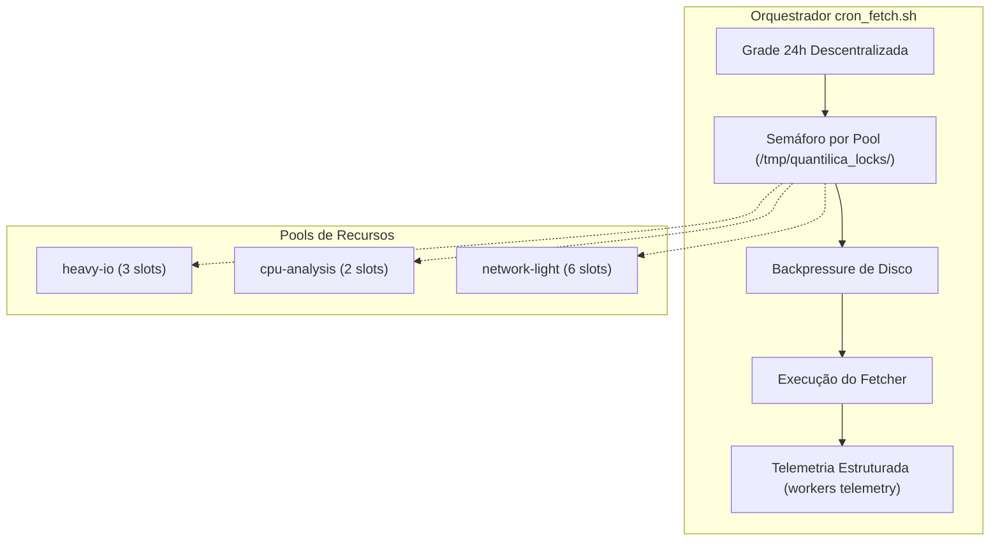

# Operação e Concorrência de Crons

Esta norma documenta a operação do orquestrador de coletas [`infra/cron_fetch.sh`](https://github.com/Quantilica/Quantilica/blob/main/infra/cron_fetch.sh) na estação **`fedora`** (Linux local, 32 GB RAM, 8 vCPUs), os pools de recursos concorrentes, proteção contra exaustão de disco e emissão de telemetria.

---

## 1. Topologia e Arquitetura

O subsistema de coleta do ecossistema Quantilica opera na estação de coleta `fedora`, mantendo os dados brutos temporários em `$DATA_DIR` (`~/data`) antes da replicação para o Data Lake e custódia fria.



---

## 2. Catálogo de Pools de Concorrência

Em substituição à antiga fila serial única (`quantilica_cron_heavy.lock`), os 25 fetchers do ecossistema são categorizados em **três pools de concorrência** baseados em semáforos no sistema de arquivos (`/tmp/quantilica_locks/<pool>/slot_<N>.lock` via `flock`):

| Pool | Slots | Teto Teórico de RAM | Perfil de Consumo | Fontes Alocadas |
|---|---|---|---|---|
| `heavy-io` | **3 slots** | 12,0 GB | Microdados e acervos volumosos, downloads > 100 MB | `comex`, `anac`, `tse`, `rfb-cnpj`, `pdet`, `datasus`, `td`, `tesouro-direto`, `inmet`, `anp`, `b3`, `pgfn`, `ons`, `capes`, `transparencia-sp`, `antt` |
| `cpu-analysis` | **2 slots** | 12,0 GB | Parsing complexo, decompress in-stream, centenas de sub-arquivos | `cvm`, `inep`, `bcb-microdados` |
| `network-light` | **6 slots** | 3,0 GB | APIs REST, JSON leve, séries curtas | `rtn`, `bcb-sgs`, `sidra`, `loterias`, `ipeadata`, `infosiga`, `sigtap` |

$$\text{Pico Máximo Agregado} = 12{,}0\text{ GB} + 12{,}0\text{ GB} + 3{,}0\text{ GB} = \mathbf{27{,}0\text{ GB}} \le 32\text{ GB}$$

A margem permanente de **5,0 GB** é estritamente preservada para o sistema operacional Linux, page cache e o PostgreSQL de ingestão.

---

## 3. Variáveis de Ambiente

As seguintes variáveis configuram o comportamento do script `infra/cron_fetch.sh`:

| Variável | Padrão | Descrição |
|---|---|---|
| `CRON_USE_POOLS` | `false` | Ativa os pools de semáforos concorrentes (`true`/`1`). Se `false`, opera no modo de compatibilidade serial. |
| `CRON_POOL_HEAVY_IO_SLOTS` | `3` | Quantidade de slots paralelos no pool `heavy-io`. |
| `CRON_POOL_CPU_ANALYSIS_SLOTS` | `2` | Quantidade de slots paralelos no pool `cpu-analysis`. |
| `CRON_POOL_NETWORK_LIGHT_SLOTS` | `6` | Quantidade de slots paralelos no pool `network-light`. |
| `CRON_POOL_HEAVY_IO_TIMEOUT` | `21600` | Timeout em segundos (6h) aguardando liberação de slot `heavy-io`. |
| `CRON_DISK_WARN_GB` | `25` | Limite de espaço livre em GB para aviso de backpressure. |
| `CRON_DISK_PAUSE_GB` | `10` | Limite crítico em GB que suspende novos downloads até liberação de espaço. |
| `CRON_DISK_RESUME_GB` | `35` | Nível mínimo de espaço livre em GB para retomar tarefas pausadas. |
| `QUANTILICA_TELEMETRY_SPOOL` | `~/.quantilica/telemetry_spool.db` | Caminho do banco SQLite de spool offline para telemetria. |

---

## 4. Backpressure de Disco

Durante downloads maciços em redes Gigabit, a velocidade de entrada pode superar a velocidade de upload e descarte efêmero. O `cron_fetch.sh` monitora o disco local:
- **Espaço < 25 GB:** emite log de advertência e cria a flag `.backpressure` em `$DATA_DIR`.
- **Espaço < 10 GB:** suspende ativamente a inicialização do fetcher em laço de espera de 15 segundos (até 1 hora), aguardando que o daemon `ingest stream` realize upload, valide integridade SHA-256 e remova arquivos locais para restaurar $\ge 35\text{ GB}$ livres.

---

## 5. Telemetria e Observabilidade

O ciclo de vida de cada execução emite eventos estruturados via `workers.cli telemetry emit`:
- **`start`:** registra o início da execução com metadados do comando;
- **`heartbeat`:** atualiza o timestamp de atividade para tarefas longas;
- **`finish`:** registra encerramento com status (`completed`, `failed` ou `timeout`), código de saída, duração e espera por slot em segundos.

### Banco de telemetria
Os eventos são gravados em `core.task_run` e `core.task_run_log` do banco de `TELEMETRY_DATABASE_URI`. No `fedora`, esse banco é o `quantilica_ingest`, que não é recriado: o `quantilica` (`DATABASE_URI`) é restaurado do dump da VPS todo dia pelo `sync-db.sh`. Sem a variável, a telemetria usa o `DATABASE_URI`. O schema `core`, as tabelas e o tipo de status são criados no primeiro uso. O reaper do `fedora` é `workers.cli cleanup --telemetry`, que limpa nesse mesmo banco.

### Spool Offline SQLite
Se o PostgreSQL estiver temporariamente inacessível, o módulo de telemetria enfileira os eventos no banco SQLite local (`telemetry_spool.db`, com fallback defensivo para `/tmp/quantilica_telemetry_spool.db`). Na execução seguinte com banco disponível ou com o argumento `--flush`, os registros são transferidos deterministicamente para `core.task_run` e `core.task_run_log`.

---

## 6. Solução de Problemas e Contingência

### Como verificar slots em uso
```bash
ls -l /tmp/quantilica_locks/*/*.lock
fuser /tmp/quantilica_locks/heavy-io/slot_*.lock
```

### Recuperação de lock órfão
O `cron_fetch.sh` verifica o estado do processo detentor (`/proc/<PID>/status`). Se o processo estiver ausente, em estado `Z` (zumbi) ou `T` (parado), o lock é recuperado automaticamente.
Para forçar a liberação manual de um slot preso:
```bash
# Identifica o processo travado
fuser /tmp/quantilica_locks/heavy-io/slot_0.lock
# Mata o processo e remove o arquivo de lock
kill -9 <PID>
rm -f /tmp/quantilica_locks/heavy-io/slot_0.lock
```
